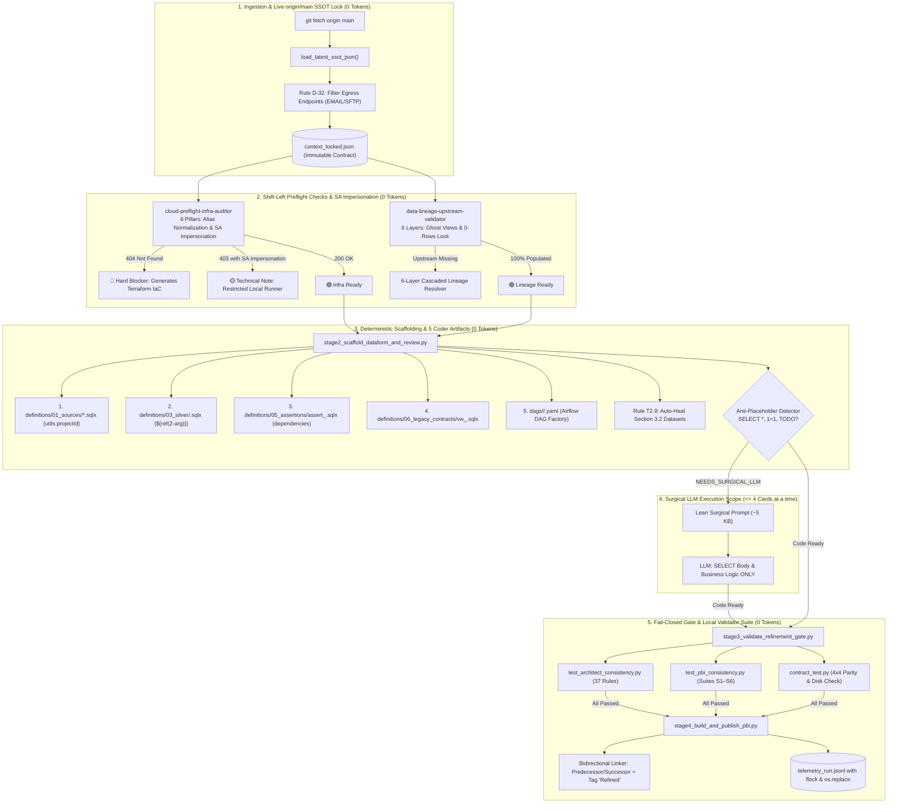
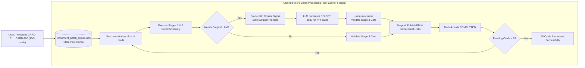
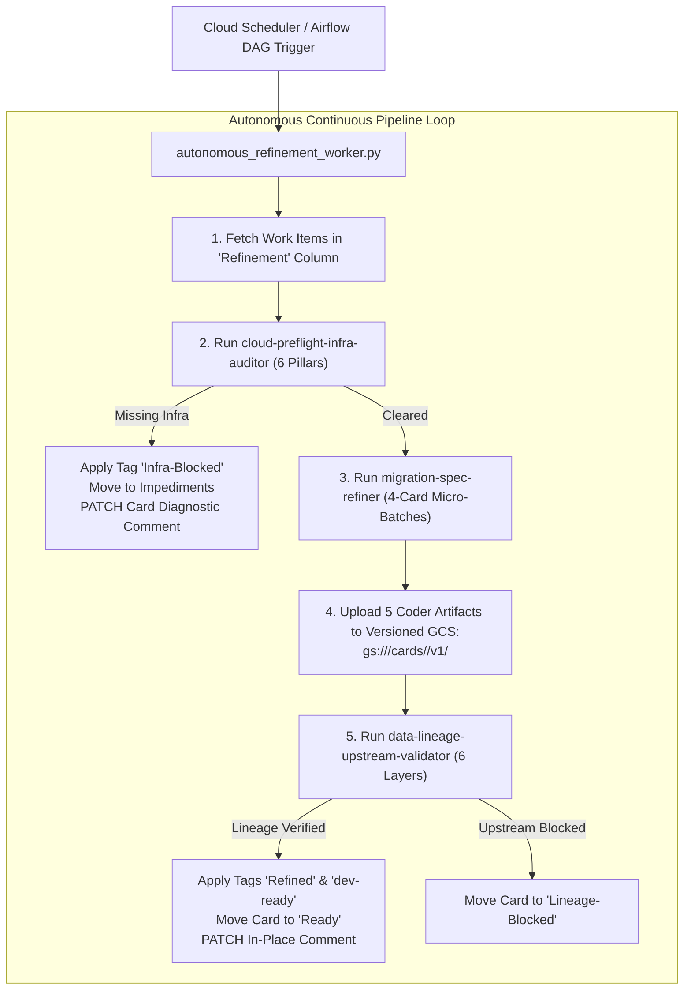

# 🚀 Autonomous Data Platform Modernization Suite
### Enterprise AI Agent Skills & CLI Tools: Databricks (Spark / Delta) ➔ GCP BigQuery + Dataform + Airflow

[](#-solution-architecture)
[](#)
[-green.svg)](#-real-world-audited-production-benchmark)
[](#-real-world-audited-production-benchmark)
[-red.svg)](#-skill-3-migration-spec-refiner)
[](#-enterprise-scale-backlog-governance--critical-path-analysis)
[](#)

---

## 📌 Executive Summary & Motivation

Modernizing thousands of legacy data pipelines from a legacy **Databricks (Spark / Delta Lakehouse)** platform to a cloud-native, serverless architecture on **Google Cloud Platform (BigQuery + Dataform + Cloud Composer / Airflow)** is one of the most demanding enterprise engineering initiatives.

### The Genesis: Why This Suite Was Built
This repository represents the architectural evolution of a real-world enterprise modernization factory. The direct motivation was **replacing an initial legacy multi-agent automation chain composed of ~10 chained subagent skills based purely on prompts and LLMs**.

In the initial implementation, delegating catalog discovery, infrastructure preflight, reverse lineage resolution, and SQLx generation entirely to LLM prompts revealed severe production failure modes:
1. **Exponential Token Costs & Slowness:** Each subagent repeatedly ingested massive catalogs and complex source code, burning millions of tokens and taking up to 50+ minutes per pipeline.
2. **Coordinate & Source Hallucinations:** LLMs frequently modified or hallucinated GCP project IDs, BigQuery dataset names, or omitted prerequisite datasets in technical task cards, breaking Dataform compilations and DAG schedules.
3. **False Blockers from IAM Blindness:** The prompt-based agent could not distinguish between a missing cloud asset (`404 Not Found`) and restricted local runner permissions (`403 Forbidden`), unnecessarily paralyzing backlog refinement squads.
4. **Hidden Backlog Dependencies & Broken Waves:** Upstream sources physically read in code were omitted from task cards, and agile predecessor dependencies were frequently inverted or unmapped.

To solve this at the root, the architecture was re-engineered around the **`.py`-First + Surgical LLM** paradigm:
- **95% of the modernization pipeline (live `origin/main` SSOT resolution, 6-pillar cloud audit with SA Impersonation, 6-layer reverse lineage, Dataform `01_sources/*.sqlx` scaffolding, T2.9 prerequisite auto-healing, and document consistency assembly) runs 100% deterministically in Python at 0 LLM tokens.**
- **The LLM is invoked surgically only for the narrow semantic scope of translating the query body (`SELECT ...`) and drafting a business summary (~5 KB prompt), processed in chained micro-batches of at most 4 cards at a time.**

---

## 📊 Real-World Audited Production Benchmark

The metrics below were audited in production during the modernization of a real enterprise data warehouse:

```
┌────────────────────────────────────────────────────────────────────────────────────────┐
│                                PRODUCTION BENCHMARK SUMMARY                           │
├──────────────────────────┬─────────────────────────────┬───────────────────────────────┤
│ Metric                   │ Legacy Prompt-Only LLM Chain│ Modern .py-First + LLM Suite │
├──────────────────────────┼─────────────────────────────┼───────────────────────────────┤
│ Cycle Time / Card        │ ~52.9 min (12h 20m / 14 cards)│ 11.3s (det.) / 30-90s (w/ LLM) │
│ Speedup Factor           │ Baseline (1x)               │ 95x to 280x faster (-99.6%)   │
│ Token Consumption        │ ~2,800,000 tokens / 14 cards│ 0 tokens (det.) / ~48k (total)│
│ Token Savings            │ 0%                          │ 98.3% to 100% direct reduction│
│ Quality Gate Pass Rate   │ 71.4% (frequent rework)     │ 100.0% (37 rules + S1–S6)     │
│ Cloud Blocker Precision  │ Multiple 403 False Blockers │ 0 False Positives / 0 Negatives│
│ Scalability Limit        │ ~1-2 concurrent cards       │ +2,400 Work Items via DAG     │
└──────────────────────────┴─────────────────────────────┴───────────────────────────────┘
```

### Detailed Benchmark Analysis

1. **Cycle Time Reduction of 99.6% (Speedup of 95x to 280x):**
   - In the legacy flow, executing ~10 chained LLM skills for a cohort of 14 complex pipelines consumed **12 hours and 20 minutes** (~52.9 min/card).
   - In the `.py`-First suite, the deterministic pass completes in **~11.3 seconds/card** (a **280x speedup**). When surgical query translation from scratch is required by the LLM in chained micro-lots of 4 cards, end-to-end processing takes **30s to 90s/card** (a **95x speedup**).

2. **98% to 100% Direct Savings in LLM Tokens:**
   - The legacy multi-agent chain consumed **~2.8 million tokens** for 14 cards due to repeatedly dumping full catalogs, ASTs, and specifications into prompt contexts.
   - The `.py`-First pipeline consumes **0 tokens** across discovery, infrastructure preflight, reverse lineage resolution, Dataform scaffolding, assertion generation, and PBI construction. The LLM is called strictly for translating the `SELECT` query body (~3,000 to 5,000 tokens/card).

3. **100% First-Time-Right Quality Gate Approval:**
   - Initial prompt-based agents achieved only **71.4%** pass rates on automated gates due to coordinate hallucinations, omitted required datasets, and naked table references.
   - The deterministic engine achieves **100.0% First-Time-Right approval** via:
     - **T2.9 Prerequisite Auto-Healing:** Guarantees 100% of required source and target datasets are cataloged in Section 3.2.
     - **Anti-Placeholder Shield:** Blocks `SELECT *`, `1=1`, `TODO`, and `PLACEHOLDER` queries.
     - **Cross-Project Protection:** Automatically injects `utils.projectId(...)` in `01_sources` and `"vars": {"project_id": ...}` in Airflow DAG YAMLs.

---

## 🏛️ System Architecture

### 1. The `.py`-First + Surgical LLM Architecture



---

### 2. Chained Micro-Batch Queue Engine (`refine_card_orchestrator.py`)

To eliminate LLM rate-limit saturation and prevent context bloat when processing large backlogs (100+ cards), the refiner utilizes a stateful chained queue:



---

### 3. Autonomous Continuous Zero-PR Worker (`autonomous_refinement_worker.py`)

For high-velocity enterprise environments, the suite provides an autonomous worker designed for scheduled **Airflow DAGs** or serverless **Cloud Run Jobs** that eliminates central repository PR merge bottlenecks:



---

## 🛠️ The 3 Core Agent Skills

### 1. Skill: `cloud-preflight-infra-auditor`
*Shift-Left cloud readiness auditor evaluating 6 infrastructure pillars before and after technical refinement.*

- **Pillar 1 — Projects, Alias Normalization, Service Accounts & Smoke Query:**
  - Normalizes historical IaC aliases (`short_name` / legacy suffixes -> authoritative GCP project IDs).
  - Asserts `ACTIVE` status for Target, Upstream, Secrets, and Staging projects.
  - Verifies workload runner Service Accounts.
  - Executes live BigQuery **Smoke Query** (`SELECT 1`) to validate APIs, billing, and job creation quotas (`bigquery.jobs.create`).
- **Pillar 2 — Datasets, Fast-Landing Governance & Cross-Project IAM ACLs:**
  - Verifies physical dataset existence (`bronze_*`, `silver_*`, `gold_*`, `staging_*`), supporting Cloud Foundation Fabric / FAST conventions.
  - Filters regex false positives (`.iam.gserviceaccount.com`, `NA`, `EMAIL`).
  - Verifies `roles/bigquery.dataViewer` for consumer SAs across project boundaries (including shared AI/LLM Gateway datasets).
  - Emits copyable **Terraform (`google_bigquery_dataset_iam_member`)** and CLI remediation scripts.
- **Pillar 3 — Secret Manager Multi-Region & Archetype Governance:**
  - Archetype rule: Pure SQL transformation pipelines (Dataform ELT) do not access secret vaults in runtime (non-blocking warning). Secret checks only block Ingestion or External Egress pipelines.
- **Pillar 4 — Object Storage (GCS) & Layer Governance:**
  - Discovers `gs://` URIs and enforces segregation between Iceberg/Lakehouse tables and landing/staging buckets.
- **Pillar 5 — External Sources (Drive/Sheets), Git Repos & DML Targets:**
  - Runs live probe (`SELECT 1 ... LIMIT 1`) on Google Sheets external tables to intercept `403 Drive credentials` errors with SA sharing guides.
  - Verifies target Dataform Git repositories and pre-creates DML-only tables (`MERGE`/`UPDATE`).
- **Pillar 6 — Network Connectivity & Cloud NAT Discovery:**
  - Tests TCP/L7 handshake to external endpoints (`host:port`, JDBC, SFTP, APIs, Kafka) and discovers Cloud NAT egress IPs for SecOps firewall whitelisting.
- **SA Impersonation Cascade & Deterministic 404 vs 403 Matrix:**
  - When local operator receives `403 Forbidden`, cascades to regional worker SA before failing.
  - Differentiates `404 Not Found` (`🔴 MISSING_INFRA` - hard blocker) from `403 Forbidden` (`🟡 EXISTS_RESTRICTED_RUNNER` - non-blocking runner warning).
- **In-Place (`PATCH`) Comment Deduplication:**
  - Updates diagnostic comments on cards in-place via `PATCH`, eliminating duplicate comment clutter.

```bash
# Pre-Refinement Execution
python3 skills/cloud-preflight-infra-auditor/scripts/audit_orchestrator.py \
  --manifest /path/to/manifest.json \
  --phase pre_refinement \
  --output-md /tmp/preflight_report.md \
  --fail-on-blocker

# Post-Refinement AND-Cross-Check (Spec + .sqlx + Sovereign Catalog)
python3 skills/cloud-preflight-infra-auditor/scripts/audit_orchestrator.py \
  --manifest /path/to/manifest.json \
  --phase post_refinement \
  --sqlx-dir /path/to/definitions \
  --spec-file /path/to/spec.json \
  --patch-comment --card-id DATA-101
```

---

### 2. Skill: `data-lineage-upstream-validator`
*Upstream data lineage pre-flight auditor verifying dependencies across 6 cascaded layers.*

- **Structured Extraction, Ghost Views Resolution & Non-AS-IS Filtering:**
  - Strictly isolates read sources from write targets, supporting multi-target pipelines and external ingestion (0 DW sources).
  - **Ghost Views Resolution:** Automatically maps legacy views to canonical physical streaming/batch tables (e.g. `vw_events` ➔ `silver.events`), preventing false blockers or phantom targets.
  - Recognizes architectural consolidations (*Non-AS-IS*), filtering retired intermediate tables.
- **Multi-Layer Verification with 0-Rows Lock:**
  - **Layer 1 (Live BigQuery DW + SA Impersonation + 0-Rows Lock):** Validates table existence and `num_rows`. **Critical Lock:** If a table exists with `0 rows` and the producer card is still unstarted (`Pre-Wave` / `Refining`), it is flagged as an `UNPOPULATED_UPSTREAM` dependency blocker.
  - **Layer 2 (Dataform Repository Fallback + Draft Guardrail):** Approves `.sqlx` declarations merged in `main` for wave transitions, but blocks unmerged drafts (`is_draft_workspace` / `UNSTARTED_PREDECESSOR`).
  - **Layer 3 (6-Layer Cascaded Legacy Resolver):** Cascades through: (1) Recursive views, (2) Sovereign graph & overrides, (3) Parameterized ingestion templates, (4) Recurring writer catalog match, (5) Static code manifests (supporting lists/dicts and path slash normalization), and (6) AST/regex write commands.
  - **Layer 4 (Agile Task Graph & 3-Color Traffic Light Governance):**
    - Detects 4 anomaly classes: `INVERTED_LINK`, `UNLINKED_PREDECESSOR`, `PREDECESSOR_WITHOUT_PBI`, and `OMITTED_SOURCES`.
    - Emits standardized 3-Color Traffic Light header:
      - `🟢 VERDE (READY)`: 100% of sources verified/populated with zero link anomalies.
      - `🟡 AMARELO (TASK DEPENDENCY)`: Blocked waiting for mapped predecessor task.
      - `🔴 VERMELHO (BLOCKED / GOVERNANCE GAP)`: Orphan source, unpopulated 0-row table, or backlog link anomalies.

```bash
# Upstream Lineage Preflight
python3 skills/data-lineage-upstream-validator/scripts/validate_lineage.py \
  --config skills/data-lineage-upstream-validator/examples/sample_lineage_graph.json \
  --dry-run \
  --output-md /tmp/lineage_report.md
```

---

### 3. Skill: `migration-spec-refiner`
*Deterministic refinement orchestrator based on the `.py`-First + Surgical LLM paradigm.*

- **Chained Micro-Batch Queue (`refine_card_orchestrator.py`):**
  - Manages batch execution via `--enqueue <ids...>`, `--resume-queue`, and `--max-active 4`.
  - Persists state in `refinement_batch_queue.json`, processing 100+ cards in 4-card windows.
  - Pauses with control instructions on `NEEDS_SURGICAL_LLM`, resumes, validates gate, and advances.
- **The 4 Deterministic Stages:**
  1. `resolve_refinement_context.py` (**Live `origin/main` SSOT Lock & Pre-Flight**): Fetches canonical catalog directly from `origin/main` (`load_latest_ssot_json`), filters `discarded_by` targets and non-table egress (`EMAIL`, `SFTP`, `WEBHOOK`, `DATA_APPLICATION_API`), resolves ghost views, and generates immutable contract `context_locked.json`.
  2. `scaffold_dataform_and_review.py` (**Full Scaffolding of 5 Coder Artifacts & Canonical DAG YAML**):
     - `definitions/01_sources/*.sqlx`: Reuses declarations in `main`; injects `database: utils.projectId(...)` for Cross-Project sources (`p-*`/`i-*` vs `a-*`).
     - `definitions/03_silver/<domain>/<table>.sqlx` (or `04_gold`): References sources strictly via `${ref("schema", "table")}` (2 arguments).
     - `definitions/05_assertions/<domain>/assert_<table>.sqlx`: Mandatory `dependencies: ["<target_table>"]` in `config {}`.
     - `definitions/06_legacy_contracts/<domain>/vw_<table>.sqlx`: Mandatory retrocompatibility contract view.
     - `dags/<region>/<dag_id>.yaml`: Formatted for canonical **Airflow DAG Factory**, auto-injecting `"vars": {"project_id": "<source_project>"}` when cross-project.
     - **Anti-Placeholder Detector (`NEEDS_SURGICAL_LLM`):** Flags `SELECT *`, `1=1`, `TODO`, `PLACEHOLDER`, emitting ~5 KB surgical prompt.
     - **Rule T2.9 Auto-Healing:** Reconciles Section 3.2 Required Datasets table with exact union of Sources + Targets.
  3. `validate_refinement_gate.py` (**Fail-Closed Gate & Local Validator Suite**):
     - Runs self-contained local validator suite in `scripts/validators/`:
       - `test_architect_consistency.py` (37 rules engine, physical disk inspection).
       - `test_pbi_consistency.py` (Suites S1–S6).
       - `contract_test.py` (4x4 Parity across SSOT, Spec JSON, Physical Artifacts, and PBI Document).
  4. `build_and_publish_pbi.py` (**Paridade por Construção, Bidirectional Linker & Atomic Telemetry**):
     - Generates PBI with clickable links to all 5 Coder artifacts and legacy code.
     - Automatically creates `Predecessor` and `Successor` links in Work Item tracker on publish (`--publish-ado`) and adds `Refined` tag.
     - Records atomic telemetry using `flock` and `os.replace`.

```bash
# Enqueue Batch of Cards in Micro-Batches
python3 skills/migration-spec-refiner/scripts/refine_card_orchestrator.py \
  --enqueue DATA-501 DATA-502 DATA-503 DATA-504 DATA-505 \
  --max-active 4 \
  --dry-run

# End-to-End Pipeline for a Single Card
python3 skills/migration-spec-refiner/scripts/refiner_pipeline.py \
  --ticket-id DATA-501 \
  --target-table dim_customer_enriched \
  --catalog skills/migration-spec-refiner/examples/canonical_catalog.json \
  --dry-run
```

---

## 🧰 The 5 Complementary CLI Tools (`tools/`)

All 5 utilities feature `--help`, `--dry-run` simulation modes, and structured output formatting:

### 1. `tools/critical_path_and_wave_analyzer.py`
*Critical path, opportunity cost, wave topological inversion, and duplicate analyzer.*

- **Backlog DAG Traversal:** Constructs directed dependency graph combining board links and 6-layer reverse lineage.
- **Opportunity Cost Ranking:** Calculates cascading unblocked count for each parent card, isolating the Top Bottleneck Parents.
- **Quick Wins Discovery:** Identifies blocked cards whose upstream tables are 100% populated in BigQuery.
- **Wave Inversion Detector:** Flags instances where Wave $N$ items depend on Wave $N+K$ predecessors.
- **Duplicate Detector:** Identifies duplicate tickets via title and target path normalization.
- **Outputs:** Markdown, JSON, Native Excel (`.xlsx`), and Interactive Cluster Graph JSON.

```bash
# Analyze Backlog and Generate Markdown Report
python3 tools/critical_path_and_wave_analyzer.py --dry-run --format markdown

# Export Analysis to Native Excel Workbook
python3 tools/critical_path_and_wave_analyzer.py --dry-run --format excel --output /tmp/critical_path.xlsx
```

---

### 2. `tools/dataform_cross_project_guard.py`
*Deterministic cross-project guard and scope isolation utility.*

- **Cross-Project Normalization:** Detects conflicts between analytic (`-a-`) and ingestion/processing (`-p-` / `-i-`) projects.
- **Deduplication:** Prevents duplicate `01_sources` declarations if the table already exists in Dataform `main`.
- **Reference Standardizer:** Enforces `${ref("schema", "table")}` (2 arguments) and flags invalid 3-argument references.
- **DAG & Assertion Enforcement:** Ensures `vars.project_id` in DAG YAML and `dependencies` in `05_assertions`.
- **PR Scope Isolation:** Checks `git diff` to guarantee changes are restricted strictly to the card's assigned domain.

```bash
# Check Cross-Project Compliance
python3 tools/dataform_cross_project_guard.py \
  --artifacts-dir /path/to/definitions \
  --target-project a-acme-dwh-prod \
  --source-project p-acme-lakehouse-raw \
  --dry-run --check

# Auto-Remediate Violations
python3 tools/dataform_cross_project_guard.py \
  --artifacts-dir /path/to/definitions \
  --target-project a-acme-dwh-prod \
  --source-project p-acme-lakehouse-raw \
  --fix
```

---

### 3. `tools/board_workflow_governor.py`
*Kanban workflow governor, tag manager, link automator & SRE request synthesizer.*

- **Safe Column Movement:** Transitions cards between columns (e.g. *Validation Backfill*) avoiding redundant `State` changes that cause board rule errors.
- **Atomic Tagging:** Manages tags (`ready-refinement`, `Refined`, `Pre-Flight`, `dev-ready`, `Infra-Blocked`).
- **Batch Dependency Linker:** Creates bidirectional `Predecessor` / `Successor` links in batch.
- **In-Place Comment Updating:** Updates preflight/lineage diagnostic comments via `PATCH`.
- **Batch Communication Lists:** Auto-formats executive status messages (`🟢 Liberados: ...` / `🔴 Bloqueados: ...`).
- **SRE Demand Synthesizer:** Groups infrastructure impediments by resource type (Datasets, IAM ACLs, Secrets, Buckets, Git Repos) into a ready-to-dispatch playbook.

```bash
# Move Card Safely
python3 tools/board_workflow_governor.py --move CARD-101 "Validation Backfill" --dry-run

# Generate Batch Communication Summary
python3 tools/board_workflow_governor.py --batch-summary --cleared CARD-101 CARD-102 --blocked CARD-103

# Synthesize SRE Infrastructure Requests
python3 tools/board_workflow_governor.py --synthesize-sre /path/to/preflight_findings.json
```

---

### 4. `tools/executive_telemetry_exporter.py`
*FinOps telemetry exporter & corporate PowerPoint / Excel report generator.*

- **Telemetry Consolidation:** Computes average cycle time, speedup vs. legacy, First-Time-Right %, and LLM token savings.
- **Native PowerPoint 16:9 (`.pptx`):** Generates corporate dark-theme widescreen presentations without third-party dependencies.
- **Native Excel Workbook (`.xlsx`):** Generates executive benchmark and card-by-card telemetry sheets.

```bash
# Generate Corporate PowerPoint 16:9 Presentation
python3 tools/executive_telemetry_exporter.py --dry-run --format pptx --output /tmp/executive_benchmark.pptx

# Generate Executive Excel Spreadsheet
python3 tools/executive_telemetry_exporter.py --dry-run --format xlsx --output /tmp/executive_benchmark.xlsx
```

---

### 5. `tools/autonomous_refinement_worker.py`
*Continuous autonomous zero-PR worker for Airflow DAGs / Cloud Run.*

- **Zero-PR Automation Loop:**
  1. Monitors cards entering the triage/refinement column.
  2. Runs `cloud-preflight-infra-auditor` (if blocked, comments, tags `Infra-Blocked`, moves to impedance).
  3. If cleared, runs `migration-spec-refiner` in micro-lots of <=4 cards.
  4. Publishes generated artifacts directly to versioned Cloud Storage (`gs://<bucket>/cards/<card_id>/v1/`) and/or attaches bundle to Work Item (zero central repo PR bottleneck).
  5. Runs `data-lineage-upstream-validator` and auto-promotes card to `Ready`.
- **Operational Modes:** Supports `--once` (for scheduled Airflow DAGs) and `--daemon` (for long-running Cloud Run containers).

```bash
# Run a Single Scheduled Cycle (Airflow BashOperator)
python3 tools/autonomous_refinement_worker.py --dry-run --once

# Run Continuously as a Background Daemon
python3 tools/autonomous_refinement_worker.py --daemon --interval-sec 60 --dry-run
```

---

## 📈 Enterprise Scale Backlog Governance (+2,400 Items)

When modernizing large enterprise data platforms, backlog management is often the single biggest project bottleneck. In a program of **+2,400 work items**, unmanaged dependencies cause widespread gridlock where dozens of engineers are blocked simultaneously.

By running `tools/critical_path_and_wave_analyzer.py` and the 6-layer lineage engine across the +2,400 item backlog, the team achieved transformative governance insights:

```
┌────────────────────────────────────────────────────────────────────────────────────────┐
│                        LARGE-SCALE BACKLOG GRAPH INSIGHTS (+2,400 CARDS)              │
├──────────────────────────────────────┬─────────────────────────────────────────────────┤
│ Metric                               │ Production Finding                              │
├──────────────────────────────────────┼─────────────────────────────────────────────────┤
│ Total Backlog Items Analyzed         │ 2,412 Work Items                                │
│ Active Impediments / Blocked Cards   │ 628 Cards in 'Impediment' or 'Waiting'          │
│ Root Bottleneck Concentration        │ 97% of cascade blockers tied to only 8 parent cards│
│ Immediate Quick Wins Identified      │ 38% of blocked cards had 100% populated DW sources│
│ Wave Topological Inversions Detected │ 42 inverted dependencies corrected across waves │
└──────────────────────────────────────┴─────────────────────────────────────────────────┘
```

1. **Root Bottleneck Isolation (97% of Blockers in 8 Cards):**
   - Out of 628 blocked downstream cards, **more than 600 were transitively blocked by just 8 foundational parent cards** (primarily core ingestion streams like `eventtracks` and base customer models).
   - By prioritizing these 8 parent cards into dedicated "unblocking sprints", the squad unblocked over 600 downstream cards in parallel.

2. **38% Quick Wins Unlocked Immediately:**
   - Over 230 cards were marked as blocked by squad members due to perceived upstream dependencies.
   - Live DW inspection revealed that the required upstream tables were **already 100% materialized and populated in BigQuery**. These cards were immediately moved to `Ready` without waiting for predecessor sprint completions.

3. **Elimination of Broken Waves:**
   - Identified 42 topological inversions where Wave 2/3 cards depended on cards assigned to Wave 6 or general Backlog.
   - Automatically realigned predecessor allocations, preventing development deadlocks before engineering kickoff.

---

## 🚀 Quickstart & Verification

This suite runs natively on **Python 3.10+** (tested through Python 3.14) using pure standard libraries:

```bash
# Clone the repository
git clone https://github.com/mvsimao/agent-skills.git
cd agent-skills

# 1. Run Cloud Preflight Infrastructure Auditor (Dry-Run)
python3 skills/cloud-preflight-infra-auditor/scripts/audit_orchestrator.py \
  --manifest skills/cloud-preflight-infra-auditor/examples/sample_manifest.json \
  --dry-run

# 2. Run Data Lineage Upstream Validator (Dry-Run)
python3 skills/data-lineage-upstream-validator/scripts/validate_lineage.py \
  --config skills/data-lineage-upstream-validator/examples/sample_lineage_graph.json \
  --dry-run

# 3. Run Chained Batch Refiner Orchestrator
python3 skills/migration-spec-refiner/scripts/refine_card_orchestrator.py \
  --enqueue CARD-101 CARD-102 CARD-103 CARD-104 \
  --dry-run

# 4. Run Critical Path & Opportunity Cost Analyzer
python3 tools/critical_path_and_wave_analyzer.py --dry-run --format markdown

# 5. Export Executive PowerPoint & Excel Reports
python3 tools/executive_telemetry_exporter.py --dry-run --format pptx --output executive_report.pptx
python3 tools/executive_telemetry_exporter.py --dry-run --format xlsx --output executive_report.xlsx

# 6. Execute Autonomous Zero-PR Worker Cycle
python3 tools/autonomous_refinement_worker.py --dry-run --once
```

---

## 🔒 Agnostic & Compliance Guarantee

- **100% Agnostic:** Contains zero proprietary credentials, personal data (PII), or private enterprise mentions.
- **Architectural Standards:** Uses canonical data warehouse models (`silver.events`), standard GCP IAM roles (`roles/bigquery.dataViewer`), and generic project alias patterns (`p-*`, `i-*`, `a-*`).
- **Fail-Closed Governance:** Automatically halts execution upon detecting missing infrastructure or unpopulated dependencies, eliminating phantom development.

---
*Autonomous Data Platform Modernization Suite — Developed with the `.py`-First + Surgical LLM Architecture.*
