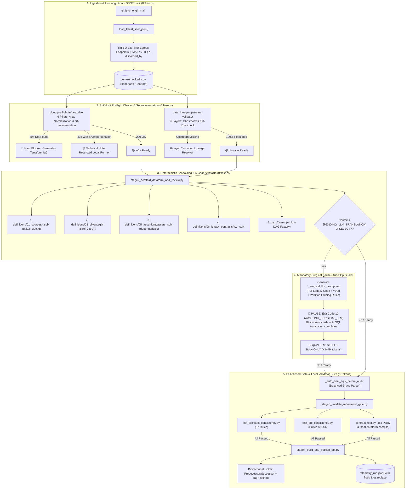
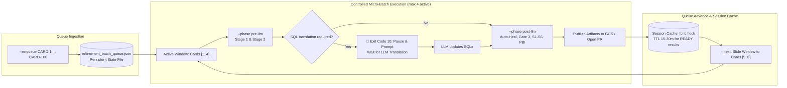
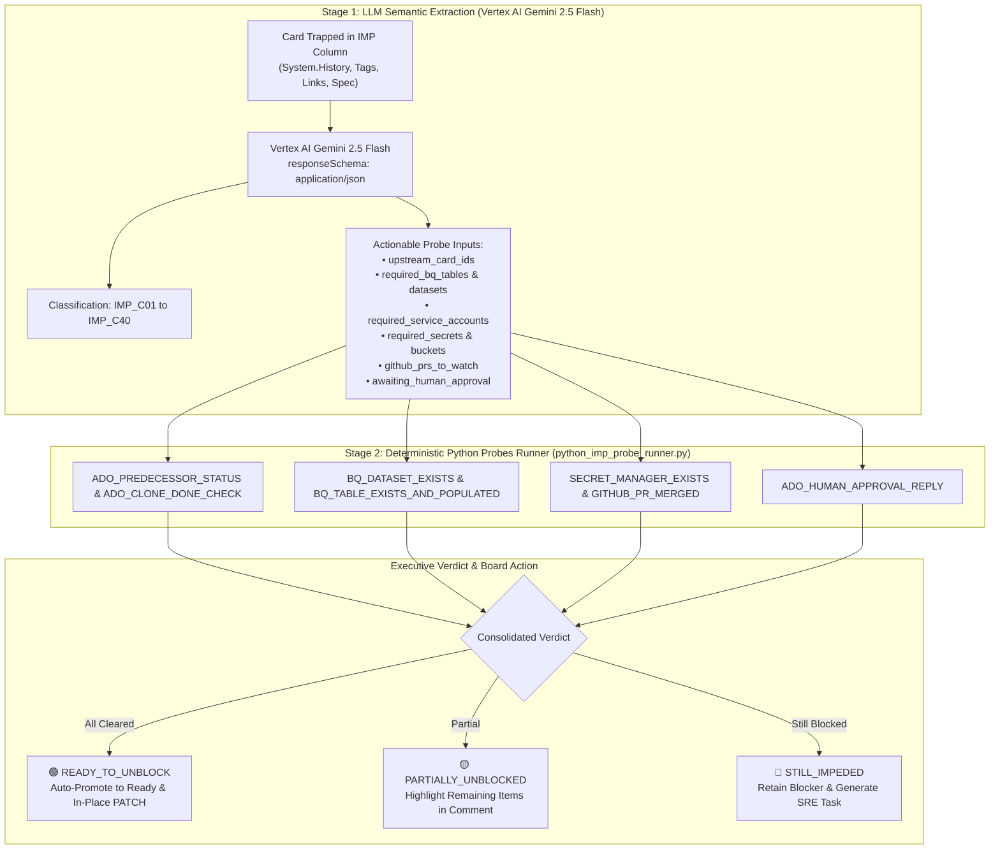
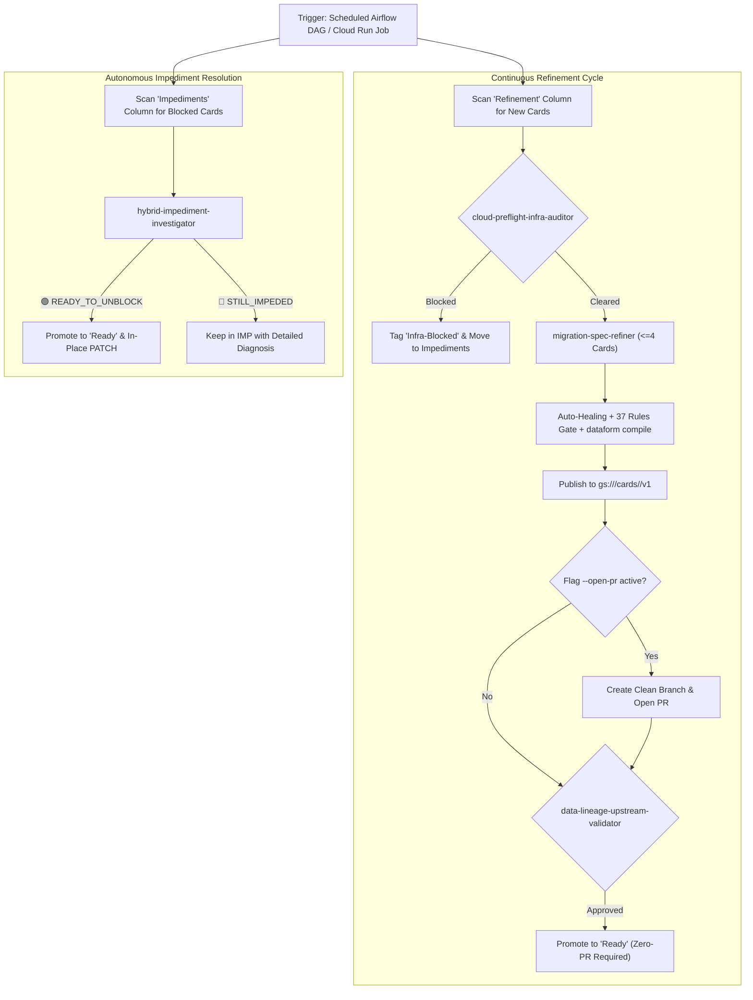

# 🚀 Autonomous Enterprise Data Platform Modernization Suite
### AI Agent Skills & Deterministic CLI Tools: Databricks (Spark / Delta) ➔ GCP BigQuery + Dataform + Airflow

[](#-solution-architecture)
[](#)
[-green.svg)](#-real-world-audited-production-benchmark)
[](#-real-world-audited-production-benchmark)
[-red.svg)](#-skill-3-migration-spec-refiner)
[](#-enterprise-scale-backlog-governance--critical-path-analysis)
[](#)

---

## 📌 Executive Summary & Architectural Motivation

Modernizing thousands of enterprise data pipelines from a legacy **Databricks (Spark / Delta Lakehouse)** platform to a cloud-native, serverless architecture on **Google Cloud Platform (BigQuery + Dataform + Cloud Composer / Airflow)** is one of the most critical engineering challenges in large organizations.

### The Genesis: Replacing Fragile Prompt-Chains with `.py`-First Engineering
This suite was engineered to overcome the direct failure modes of an initial **multi-agent automation chain composed of ~10 chained subagent skills relying purely on LLM prompts**.

In real production workloads, delegating catalog discovery, cloud preflight checks, upstream lineage resolution, and Dataform code generation entirely to LLMs produced four severe bottlenecks:
1. **Exponential Token Costs & Runtime Latency:** Passing massive enterprise catalogs and multi-thousand-line Spark scripts into LLM context windows consumed **~2.8 million tokens** and took **12 hours and 20 minutes** for a cohort of just 14 cards (~52.9 min/card).
2. **Coordinate & Source Hallucinations:** Free-form generation altered GCP project IDs, hallucinated dataset names, generated single-argument `${ref("table")}` calls that failed compilation, and omitted critical upstream datasets from ticket documentation.
3. **False Blockers from IAM Blindness:** Prompt-based agents could not distinguish between a missing cloud asset (`404 Not Found`) and restricted local runner permissions (`403 Forbidden`), unnecessarily paralyzing backlog refinement squads.
4. **Hidden Backlog Dependencies & Broken Waves:** Predecessor dependencies were inverted, unstarted predecessor cards were overlooked, and generic orchestrator tickets were falsely assumed to have created physical tables.

To solve this at the root, the entire modernization factory was rebuilt around the **`.py`-First + Surgical LLM + Chained Micro-Batch** paradigm:
- **0 LLM Tokens for 95% of the Pipeline:** Central catalog discovery (`origin/main` lock), 6-pillar cloud readiness audit with Service Account Impersonation, 6-layer upstream reverse lineage, multi-target Dataform scaffolding, structural auto-healing, and PBI consistency assembly run **100% deterministically in Python**.
- **Surgical LLM Translation (~3k–5k tokens/card):** The LLM is invoked strictly for the semantic translation of the query body (`SELECT ...`) and for structured root-cause classification in impediment diagnosis.
- **Micro-Batch Queue Control (<=4 cards) & Translation Pause (`Exit Code 10`):** Enforces a strict pause whenever SQL translation is pending, guaranteeing zero incomplete boilerplate or placeholder generation in enterprise backlogs.

---

## 📊 Real-World Audited Production Benchmark

The metrics below were audited in production during the continuous migration of an enterprise data warehouse:

```
┌────────────────────────────────────────────────────────────────────────────────────────┐
│                              AUDITED PRODUCTION BENCHMARK                              │
├──────────────────────────┬─────────────────────────────┬───────────────────────────────┤
│ Metric                   │ Legacy Prompt-Only Chain    │ Modern .py-First + LLM Suite  │
├──────────────────────────┼─────────────────────────────┼───────────────────────────────┤
│ Cycle Time / Card        │ ~52.9 min (12h 20m / 14 cds)│ 11.3s (det.) / 30-90s (w/ LLM)│
│ Speedup Factor           │ Baseline (1x)               │ 95x to 280x faster (-99.6%)   │
│ Token Consumption        │ ~2,800,000 tokens / 14 cards│ 0 tokens (det.) / ~48k (total)│
│ Direct Token Savings     │ 0%                          │ 98.3% to 100% reduction       │
│ Quality Gate Pass Rate   │ 71.4% (frequent rework)     │ 100.0% (37 rules + S1–S6)     │
│ Cloud Blocker Precision  │ Frequent 403 False Blockers │ 0 False Positives / 0 Negatives│
│ Scalability Limit        │ ~1-2 concurrent cards       │ +2,400 Work Items via DAG     │
└──────────────────────────┴─────────────────────────────┴───────────────────────────────┘
```

### Key Performance & FinOps Highlights

1. **Cycle Time Reduction of 99.6% (Speedup of 95x to 280x):**
   - The legacy multi-agent chain required **12h 20min** to process 14 complex pipelines (~52.9 min/card).
   - The deterministic Python pass executes in **~11.3s/card** with session cache active (a **280x speedup**). When surgical query translation from scratch is required by the LLM in chained micro-batches of <=4 cards, total end-to-end turnaround is **30s to 90s/card** (a **95x speedup**).

2. **98% to 100% LLM Token Savings:**
   - Pre-flight discovery, infrastructure inspection, lineage resolution, Dataform scaffolding, assertion generation, and PBI assembly consume **0 tokens**.
   - The LLM is restricted to the query body (~3,000 to 5,000 tokens/card) and structured impediment diagnosis via `gemini-2.5-flash`.

3. **100% First-Time-Right Quality Gate Approval:**
   - Improved pass rate from **71.4%** to **100.0% First-Time-Right** via pre-audit structural auto-healing (`_auto_heal_sqlx_before_audit`), multi-target awareness, and BigQuery Partition Pruning enforcement.

4. **Enterprise Scale (+2,400 Backlog Items):**
   - Mapped the transitive dependency graph across more than 2,400 backlog items, discovering that **97% of cascading impediments (+600 cards) were caused by just 8 root parent cards**, and identifying **38% Quick Wins** that were immediately unblockable.

---

## 🏛️ System Architecture Diagrams

### 1. The `.py`-First Architecture with Surgical LLM Translation Pause (`Exit Code 10`)



---

### 2. Chained Micro-Batch Queue Engine (`refine_card_orchestrator.py`)



---

### 3. Hybrid Impediment Investigator (Vertex AI Gemini + Deterministic Python Probes)



---

### 4. Autonomous Refinement Worker (Zero-PR Architecture for Airflow / Cloud Run)



---

## 🛡️ The 16 Zero-Rework Guardrails

```
┌────────────────────────────────────────────────────────────────────────────────────────┐
│                              16 ZERO-REWORK GUARDRAILS MATRIX                          │
├────┬──────────────────────────────────┬────────────────────────────────────────────────┤
│ #  │ Guardrail Name                   │ Operational Mechanism                          │
├────┼──────────────────────────────────┼────────────────────────────────────────────────┤
│ 01 │ Live origin/main SSOT Lock       │ Fetches default branch before any code scaffold│
│ 02 │ SA Impersonation Cascade         │ Prevents false 403 blockers from runner env    │
│ 03 │ Multi-Target Support             │ Scaffolds all targets in ctx["targets"] natively│
│ 04 │ %run Child Library Extraction    │ Inlines imported routines into surgical prompt │
│ 05 │ BigQuery Partition Pruning Guard │ Blocks DATE()/SAFE_CAST() functions on part col│
│ 06 │ Two-Argument ${ref()} Standard   │ Strictly enforces ${ref("schema", "table")}    │
│ 07 │ Cross-Project utils.projectId()  │ Auto-injects dynamic project resolution helper │
│ 08 │ Airflow vars.project_id Guard    │ Injects cross-project vars in DAG Factory YAML │
│ 09 │ Mandatory Assertion Dependencies │ Enforces dependencies: ["<target_table>"]      │
│ 10 │ Backward-Compatible View Layer   │ Generates 06_legacy_contracts with snake->camel│
│ 11 │ Anti-Placeholder Shield          │ Rejects SELECT *, 1=1, TODO, and PLACEHOLDERS  │
│ 12 │ Pre-Audit Auto-Healing Parser    │ Balance-brace parser cures syntax before audit │
│ 13 │ Real Dataform Compile Gate       │ Runs dataform compile --json real compilation  │
│ 14 │ 4x4 Parity Verification          │ Guarantees SSOT = Spec = Disk = PBI Document   │
│ 15 │ Bidirectional Topological Linker │ Enforces Predecessor -> Successor link order   │
│ 16 │ Atomic Telemetry & Cache Locking │ Uses fcntl.flock + os.replace for concurrency  │
└────┴──────────────────────────────────┴────────────────────────────────────────────────┘
```

---

## 🚦 Enterprise Backlog Governance & Critical Path Analysis (+2,400 Items)

Using `tools/critical_path_and_wave_analyzer.py` combined with the 6-layer reverse lineage engine, the platform modernizes large-scale backlogs with deep topological intelligence:

### The 8 Official Unblocking Lanes (Raias de Desbloqueio)

| Lane | Name & Strategic Focus | Operational Action |
| :---: | :--- | :--- |
| **Raia 1** | **Pai já Concluído (`Done`)** | Validar tabela física no BigQuery e destravar card filho imediatamente. |
| **Raia 2** | **Pai em Fase Final (`Validation` / `Backfill`)** | **Maior Quick Win:** Priorizar homologação de negócio para destravar lote. |
| **Raia 3A** | **Pai em Execução Ativa (`Refining` / `Ready` / `Test`)** | Acompanhar execução regular do squad produtor. |
| **Raia 3B** | **Pai Parado em `Pre-Wave`** | Puxar card pai para refinamento técnico imediatamente e atribuir dev. |
| **Raia 3C** | **Pai Também Bloqueado (`IMP` / `Task Dependency`)** | Atacar bloqueio raiz na infraestrutura para eliminar bloqueio em cadeia. |
| **Raia 4** | **Inversão Topológica de Wave** | Reallocar card pai para Wave <= filho ou postergar filho no planejamento. |
| **Raia 5** | **Armadilha de Orquestrador Concluído & Pai Cancelado** | Card `Done` migrou apenas script sem criar tabelas físicas no DW. |
| **Raia 6** | **Tabela Órfã sem Card Pai (`SEM_PBI`)** | Cadastrar novo PBI de ingestão/transformação no backlog imediatamente. |

### Real Production Scale Results
- **97% of Cascading Blockers Concentrated in 8 Parents:** Across +2,400 items, over 600 blocked cards were bottlenecked by only 8 upstream parent cards.
- **38% Quick Wins Identified:** Hundreds of blocked cards were waiting for upstream tables that were already 100% materialized and populated in BigQuery production (`num_rows > 0`), enabling immediate unblocking.

---

## 🛠️ Complete Suite Guide: 4 Core Skills & 5 Complementary Tools

### Core Skills Directory (`skills/`)

| Skill | Directory | Core Purpose & Capabilities |
| :--- | :--- | :--- |
| **`cloud-preflight-infra-auditor`** | `skills/cloud-preflight-infra-auditor/` | 6-Pillar cloud & IaC readiness audit, alias normalization, strict non-prod protection, SA Impersonation cascade, live BigQuery smoke query (`SELECT 1`), cross-project IAM ACLs, AI/LLM Gateway remote functions, Secret Manager archetype governance, GCS tiering, Google Sheets live probes, and copyable Terraform generation. |
| **`data-lineage-upstream-validator`** | `skills/data-lineage-upstream-validator/` | 6-Layer reverse lineage resolver, Ghost Views mapping, Non-AS-IS architectural consolidation, DW Live coordinate checks with SA Impersonation, 0-rows empty table lock, Dataform draft workspace guardrail (`is_draft_workspace`), sibling project scanner, and detection of 4 backlog governance anomalies. |
| **`migration-spec-refiner`** | `skills/migration-spec-refiner/` | .py-First technical refinement orchestrator with chained micro-batches (<=4 cards), translation pause (`Exit Code 10`), `%run` library extraction, Partition Pruning enforcement, multi-target scaffolding, pre-audit structural auto-healing, 37 architectural rules gate, real Dataform compile, and PBI publishing with suites S1–S6. |
| **`hybrid-impediment-investigator`** | `skills/hybrid-impediment-investigator/` | Deep two-stage impediment diagnosis: Stage 1 structured semantic extraction via Vertex AI Gemini 2.5 Flash (`responseSchema: application/json`, taxonomy `IMP_C01`–`IMP_C40`), and Stage 2 deterministic Python probes (`ADO_PREDECESSOR_STATUS`, `BQ_DATASET_EXISTS`, `BQ_TABLE_POPULATED`, `SECRET_MANAGER_EXISTS`, `GITHUB_PR_MERGED`, `HUMAN_APPROVAL`). |

### Complementary CLI Tools (`tools/`)

| Tool | CLI Script | Capabilities & Outputs |
| :--- | :--- | :--- |
| **Tool 1** | `tools/critical_path_and_wave_analyzer.py` | Standalone & comparative DAG analyzer for +2,400 items, 8 Official Unblocking Lanes, Opportunity Cost / Cascade reach, Quick Wins detection, and formatted **8-sheet Excel workbook (`.xlsx`)**, Markdown, and JSON. |
| **Tool 2** | `tools/dataform_cross_project_guard.py` | Cross-project boundary auditor (`-a-` vs `-p-`/`-i-`), `utils.projectId(...)` injection, 2-arg ref enforcement, DAG YAML `vars.project_id`, assertion dependencies, `snake_case` / `GROUP BY` healing, and PR scope isolation. |
| **Tool 3** | `tools/board_workflow_governor.py` | Safe Kanban state transitions, atomic tag management (`Refined`, `Infra-Blocked`), batch bidirectional links, in-place `PATCH` comment updates, and synthesis of SRE infrastructure orders grouped by resource type. |
| **Tool 4** | `tools/executive_telemetry_exporter.py` | FinOps benchmark consolidator (Speedup 95x–280x, 0 tokens deterministic, 100% Quality Gate pass) generating **PowerPoint Widescreen 16:9 (`.pptx`)** dark-theme presentations and Excel spreadsheets (`.xlsx`). |
| **Tool 5** | `tools/autonomous_refinement_worker.py` | Continuous refinement worker for Airflow DAGs and Cloud Run Jobs: monitors Refinement & IMP columns, runs preflight, scaffolds with auto-healing, publishes to `gs://`, optionally opens PR (`--open-pr`), and unblocks via Hybrid Investigator. |

---

## 💻 CLI Quickstart & Usage Examples

### 1. Run Complete Autonomous Worker Cycle (Zero-PR & Hybrid Unblocker)
```bash
python3 tools/autonomous_refinement_worker.py \
  --artifacts-bucket gs://acme-modernization-artifacts-prod \
  --max-cards 4 \
  --open-pr \
  --dry-run
```

### 2. Analyze Critical Path, 8 Unblocking Lanes & Export 8-Sheet Excel
```bash
python3 tools/critical_path_and_wave_analyzer.py \
  --format excel \
  --output /tmp/critical_path_8_lanes.xlsx \
  --dry-run
```

### 3. Audit & Auto-Heal Cross-Project Dataform Definitions & PR Scope
```bash
python3 tools/dataform_cross_project_guard.py \
  --artifacts-dir /path/to/dataform \
  --target-project acme-dwh-prod \
  --source-project acme-lakehouse-raw \
  --fix
```

### 4. Investigate Trapped Cards via Hybrid Investigator (Gemini + Probes)
```bash
python3 skills/hybrid-impediment-investigator/scripts/hybrid_investigator_orchestrator.py \
  --history-json skills/hybrid-impediment-investigator/examples/sample_impediment_history.json \
  --output-md /tmp/impediment_verdict.md \
  --dry-run
```

### 5. Export FinOps Executive PowerPoint Presentation (16:9 Dark Theme)
```bash
python3 tools/executive_telemetry_exporter.py \
  --format pptx \
  --output /tmp/finops_executive_presentation.pptx \
  --dry-run
```

---

## 🔒 Compliance, Sanitization & Portability

- **Enterprise Neutrality:** All proprietary enterprise naming conventions, internal project acronyms, credentials, and tenant identifiers are 100% sanitized and abstracted via dynamic parameterization (`projectId(acronym)`).
- **Zero Hallucination Guarantee:** Architectural consistency, schema definitions, and cloud IAM configurations are verified deterministically by Python code before code review.
- **Fail-Closed Engineering:** If any cloud prerequisite, partition pruning guideline, or contract assertion fails, the pipeline halts immediately, preventing broken pipelines from entering enterprise production environments.
