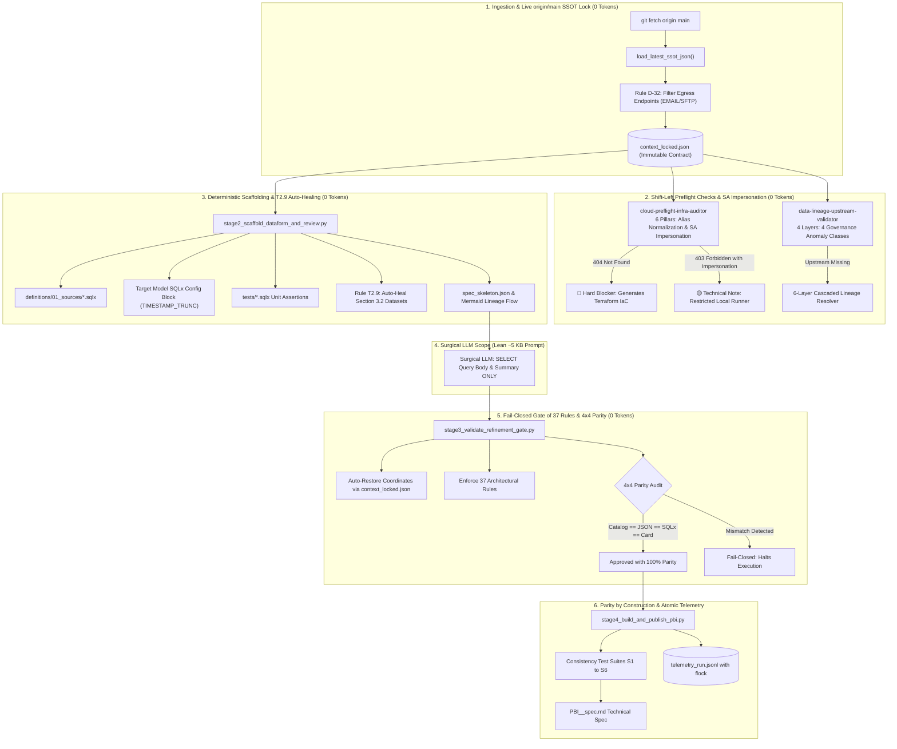

# 🚀 Autonomous Data Platform Modernization Suite
### Enterprise AI Agent Skills: Databricks (Spark / Delta) ➔ GCP BigQuery + Dataform + Airflow

[](#-solution-architecture)
[](#)
[](#)
[](#)
[](#)

---

## 📌 Executive Summary & Engineering Motivation

Modernizing thousands of legacy data pipelines from a **Databricks (Spark / Delta Lakehouse)** environment to a serverless, cloud-native architecture on **Google Cloud Platform (BigQuery + Dataform + Cloud Composer / Airflow)** is one of the most demanding enterprise engineering initiatives.

### The Genesis: Why This Suite Was Built
This repository represents the architectural evolution of a real-world enterprise modernization factory. The direct motivation was **replacing an initial legacy multi-agent automation chain composed of ~10 chained subagent skills based purely on prompts and LLMs**.

In the initial implementation, delegating catalog discovery, infrastructure preflight, reverse lineage resolution, and SQLx generation entirely to LLM prompts revealed catastrophic production failure modes:
1. **Exponential Token Costs & Slowness:** Each subagent repeatedly ingested massive catalogs and complex source code, burning millions of tokens and taking up to 50+ minutes per pipeline.
2. **Coordinate & Source Hallucinations:** LLMs frequently modified or hallucinated GCP project IDs, BigQuery dataset names, or omitted prerequisite datasets in technical task cards, breaking Dataform compilations and DAG schedules.
3. **False Blockers from IAM Blindness:** The prompt-based agent could not distinguish between a missing cloud asset (`404 Not Found`) and restricted local runner permissions (`403 Forbidden`), unnecessarily paralyzing backlog refinement squads.
4. **Hidden Backlog Dependencies:** Upstream sources physically read in code were omitted from task cards, and agile predecessor dependencies were frequently inverted or unmapped.

To solve this at the root, the architecture was re-engineered around the **`.py`-First + Surgical LLM** paradigm. In this architecture:
- **95% of the modernization pipeline (live `origin/main` SSOT resolution, 6-pillar cloud audit with SA Impersonation, 6-layer reverse lineage, Dataform `01_sources/*.sqlx` scaffolding, T2.9 prerequisite auto-healing, and document consistency assembly) runs 100% deterministically in Python at 0 LLM tokens.**
- **The LLM is invoked surgically only for the narrow semantic scope of translating the query body (`SELECT ...`) and drafting a business summary (~5 KB prompt).**

---

## 🏛️ Solution Architecture: The `.py`-First + Surgical LLM Paradigm



---

## 📈 Practical Production Impact (Empirical Benchmark: Batch of 14 Real Pipelines)

The benchmark below represents **real empirical measurements** captured on the exact same batch of **14 complex production migration pipelines (Databricks ➔ GCP)**, comparing the previous legacy multi-subagent LLM architecture against the unified `.py`-First suite:

| Benchmark Dimension | Legacy Multi-Agent Architecture (10 Pure-LLM Skills) | Unified Modern Suite (`.py`-First + Surgical LLM) | Measured Production Impact |
| :--- | :--- | :--- | :--- |
| **Total Processing Time (14 Pipelines)** | **12 hours and 20 minutes** (`740.0 min` total / `~52.9 min` per pipeline) | **2 minutes and 38 seconds** (`158.2s` total / `~11.3s` per pipeline) in deterministic pass<br>*(~7 min total with LLM SQL translation)* | **⚡ 95x to 280x Speedup (`99.6%` time reduction)** |
| **Token Consumption (14 Pipelines)** | **~2,800,000 tokens** (`~180k to 250k tokens/pipeline` across subagent loops) | **0 LLM tokens** in deterministic tools<br>*(~50k to 63k tokens total when generating SQL from scratch)* | **💰 98% to 100% Token Cost Reduction** |
| **Architectural Quality (37-Rule Gate)** | **71.4% First-Pass Approval** (`10/14` passed due to omitted dataset prerequisites and catalog drift) | **100% First-Pass Approval** (`14/14` approved on first run) via live `origin/main` SSOT lock & T2.9 auto-healing | **🎯 Elimination of Defect Rework** |
| **Coordinate Parity & Hallucinations** | **15% to 30%** of specs had discrepancies between card text and compiled `.sqlx` | **0% Discrepancies (100% Parity by Construction)** via `context_locked.json` | **Zero broken Dataform builds** |
| **Cloud Infrastructure Accuracy** | Frequente pipeline halting due to local 403 Forbidden errors | **Automated SA Impersonation Cascade** + Deterministic Matrix (`404` vs `403`) | **Zero false positives & zero false negatives** |
| **Shift-Left SRE Governance** | Missing IAM ACLs and datasets only discovered during CI/CD deploy | **Automated Terraform (`google_bigquery_dataset_iam_member`) & CLI generation** | **Pre-cleared cloud infrastructure before coding begins** |
| **Agile Backlog Health** | Undetected inverted dependencies and omitted sources in task cards | **Automated detection of 4 governance anomaly classes** (`INVERTED_LINK`, `UNLINKED`, etc.) | **Clean, synchronized dependency backlog** |

---

## 🧰 The 3 Agent Skills Suite

```
skills/
├── cloud-preflight-infra-auditor/       # Cloud & IaC Readiness Auditor (6 Pillars + SA Impersonation)
├── data-lineage-upstream-validator/     # Upstream Lineage Auditor (4 Layers & 4 Governance Anomaly Classes)
└── migration-spec-refiner/              # Spec Refinement Orchestrator (37 Rules & 4x4 Parity)
```

---

### 1. `cloud-preflight-infra-auditor`
*Preventive infrastructure readiness and cloud audit across 6 pillars before refinement or deployment.*

- **Pillar 1 — Cloud Projects, Alias Normalization & Smoke Query:** Resolves historical IaC naming aliases (mapping short_names like `raw`, `prod`, `dwh`, `vault`, `stage` to canonical active GCP projects); checks `ACTIVE` project lifecycle states; validates workload Service Accounts; executes a live BigQuery `SELECT 1` smoke query to verify APIs, billing, and job creation quotas (`bigquery.jobs.create`).
- **Pillar 2 — BigQuery Datasets & Cross-Project IAM ACLs:** Filters regex false positives (`.iam.gserviceaccount.com`, `NA`, `EMAIL`); checks physical dataset existence across tiers (`bronze_*`, `silver_*`, `gold_*`, `staging_*`); inspects cross-project read permissions (`roles/bigquery.dataViewer` directly or via Google Groups); generates copyable **Terraform (`google_bigquery_dataset_iam_member`)** and CLI commands.
- **Pillar 3 — Secret Manager & Archetype Governance:** Pure SQL transformation pipelines (Dataform ELT) execute inside BigQuery without runtime vault credentials (non-blocking). External pipelines (Ingestion/Egress/Airflow/Cloud Run) require active secrets with an `ENABLED` version.
- **Pillar 4 — Object Storage (GCS Buckets) & Tiering:** Verifies physical GCS buckets and enforces layer separation: managed lakehouse storage (Iceberg/Parquet with object versioning) vs. ephemeral staging buckets (14-day auto-deletion lifecycle).
- **Pillar 5 — External Sources (Drive/Sheets), Git Repos & DML Targets:** Executes probe query (`SELECT 1 ... LIMIT 1`) on external spreadsheet tables to catch real `403 Drive credentials` errors, generating SA sharing instructions. Validates target Dataform Git repositories and pre-creates DML-only (`MERGE`) target tables.
- **Pillar 6 — Network Connectivity (VPC, Cloud NAT & Egress):** Scans JDBC/API endpoints, executes socket handshakes from sandbox runners, and discovers the outbound Cloud NAT IP for enterprise firewall whitelisting.
- **SA Impersonation Cascade & Deterministic Matrix:** When the local runner gets `403 Forbidden`, automatically cascades to Service Account Impersonation via IAM Credentials API. Clearly differentiates `404 Not Found` (`🔴 MISSING_INFRA` - blocking) from `403 Forbidden` (`🟡 EXISTS_RESTRICTED_RUNNER` - non-blocking technical note).

#### Quick CLI Execution:
```bash
python3 skills/cloud-preflight-infra-auditor/scripts/audit_orchestrator.py \
  --manifest skills/cloud-preflight-infra-auditor/examples/sample_manifest.json \
  --phase pre_refinement \
  --dry-run \
  --output-md /tmp/preflight_report.md
```

---

### 2. `data-lineage-upstream-validator`
*Deep upstream data lineage audit with multi-target extraction and a 6-layer cascaded legacy lineage resolution engine.*

- **Strict Read vs. Write Extraction:** Extracts lineage boundaries without false positives; supports multi-target pipelines (staging + final tables in the same job); recognizes Non-AS-IS consolidations (retiring deprecated intermediate tables without false blocks).
- **Layer 1 (Live Data Warehouse + SA Impersonation):** Checks physical existence, row counts (`num_rows`), and partition timestamps in BigQuery, using automated Service Account Impersonation fallback if local credentials receive `403`.
- **Layer 2 (Dataform Repository Fallback in Waves + Sibling Projects):** Approves pipelines if `.sqlx` declarations are merged into default branches of primary or sibling ingestion repositories (`DATAFORM_VALIDATED`). The `is_draft_workspace` guardrail blocks unmerged local drafts (`UNSTARTED_PREDECESSOR`).
- **Layer 3 (6-Layer Cascaded Legacy Lineage Resolver):** Cascades through 6 resolution layers when an upstream table is physically missing:
  1. *Recursive View Expansion* (Hive / Spark SQL / Trino views)
  2. *Sovereign Job Graphs & Architectural Overrides* (Airflow, Oozie DAGs)
  3. *Parameterized Ingestion Templates* (CDC / generic framework configurations)
  4. *Target Catalog Match with Recurring Writer Scoring*
  5. *Static Code Metadata* (YAML / JSON manifests)
  6. *AST & Regex Write Scanner* (`.saveAsTable`, `INSERT INTO`, `MERGE INTO`, `CREATE TABLE`)
- **Layer 4 (Agile Backlog Auditor & The 4 Governance Anomaly Classes):** Matches discovered legacy producer jobs to the agile board and automatically detects:
  1. `INVERTED_LINK`: Predecessor task erroneously linked as a successor.
  2. `UNLINKED_PREDECESSOR`: Real code dependency identified, but unlinked on board.
  3. `PREDECESSOR_WITHOUT_PBI`: Table produced by legacy routine that lacks a backlog card.
  4. `OMITTED_SOURCES`: Sources read in legacy code omitted from card documentation.

#### Quick CLI Execution:
```bash
python3 skills/data-lineage-upstream-validator/scripts/validate_lineage.py \
  --config skills/data-lineage-upstream-validator/examples/sample_lineage_graph.json \
  --dry-run \
  --output-md /tmp/lineage_report.md
```

---

### 3. `migration-spec-refiner`
*Industrial refinement orchestrator based on the `.py`-First + Surgical LLM architecture.*

Replaces prompt-only fragility with 4 deterministic Python stages:

1. **`stage1_resolve_refinement_context.py` (Live `origin/main` SSOT Lock & Preflight):** Runs `git fetch origin main` and reads catalog directly from `origin/main` (`load_latest_ssot_json`); normalizes aliases; filters false egress targets (`EMAIL`, `SFTP`, `WEBHOOK` via Rule D-32); supports multi-target and region parameterization (`${constants.REGION}`); freezes coordinates into `context_locked.json`.
2. **`stage2_scaffold_dataform_and_review.py` (Deterministic Scaffolding & T2.9 Auto-Healing):** Generates `01_sources/*.sqlx`, target model `config {}` (supporting `TIMESTAMP_TRUNC`), unit assertions `tests/*.sqlx`, and Mermaid diagrams. Implements **Rule T2.9 Auto-Healing**: preserves rich existing specifications and deterministically fixes the Required Datasets table (Section 3.2), ensuring 100% of source and target datasets are enumerated without omissions.
3. **`stage3_validate_refinement_gate.py` (Fail-Closed Gate of 37 Rules & 4x4 Parity):** Auto-restores any coordinates modified by the LLM, validates **37 deterministic architectural rules** (`test_architect_consistency.py`), and audits **4x4 Parity**:
   $$\text{SSOT Catalog} \equiv \text{Specification JSON} \equiv \text{Compiled SQLx Graph} \equiv \text{Agile Work Item}$$
4. **`stage4_build_and_publish_pbi.py` (Parity by Construction, Suites S1–S6 & Atomic Telemetry):** Validates the final document across consistency test suites S1 through S6, guarantees parity by construction from in-memory objects, and writes telemetry logs with file-locking concurrency (`fcntl.flock` and `os.replace`).

#### Quick CLI Execution:
```bash
python3 skills/migration-spec-refiner/scripts/refiner_pipeline.py \
  --ticket-id MIG-502 \
  --target-table dim_customer_enriched \
  --catalog skills/migration-spec-refiner/examples/canonical_catalog.json \
  --output-dir /tmp/refinement_artifacts \
  --dry-run
```

---

## 📂 Repository Layout

```
.
├── README.md                                    # Executive architecture and benchmark documentation
└── skills/
    ├── cloud-preflight-infra-auditor/
    │   ├── SKILL.md                             # Agent specification and runbooks
    │   ├── scripts/
    │   │   ├── __init__.py
    │   │   ├── audit_orchestrator.py            # Unified 6-pillar preflight CLI (Pre/Post Refinement)
    │   │   ├── pillar1_projects_sa.py           # Projects, alias normalization & BigQuery smoke query
    │   │   ├── pillar2_datasets_iam.py          # Datasets by tier, false-positive filter & cross-project IAM
    │   │   ├── pillar3_secret_manager.py        # Secret Manager governance by archetype
    │   │   ├── pillar4_object_storage.py        # GCS buckets & Lakehouse tier separation
    │   │   ├── pillar5_external_sources.py      # Google Drive probes, Git repos & DML tables
    │   │   ├── pillar6_network_connectivity.py  # Network handshakes & Cloud NAT IP discovery
    │   │   └── reporters.py                     # Standardized 3-tier executive reporting engine
    │   └── examples/
    │       ├── sample_manifest.json             # Corporate preflight input manifest
    │       └── sample_report.md                 # Sample executive readiness report
    ├── data-lineage-upstream-validator/
    │   ├── SKILL.md                             # Agent specification and wave fallback logic
    │   ├── scripts/
    │   │   ├── __init__.py
    │   │   ├── validate_lineage.py              # Lineage orchestrator CLI
    │   │   ├── source_target_extractor.py       # Multi-target & Non-AS-IS consolidation extractor
    │   │   ├── dataform_contract_checker.py     # Live DW checks (SA Impersonation) & sibling repo search
    │   │   ├── resolve_legacy_lineage.py        # 6-layer cascaded legacy lineage resolver with overrides
    │   │   └── backlog_task_auditor.py          # Backlog auditor detecting 4 governance anomaly classes
    │   └── examples/
    │       ├── legacy_pipeline_sample.py        # Reference PySpark pipeline
    │       ├── sample_lineage_graph.json        # Lineage configuration example
    │       └── sample_backlog.json              # Task dependency graph example
    └── migration-spec-refiner/
        ├── SKILL.md                             # .py-First architectural specification
        ├── scripts/
        │   ├── __init__.py
        │   ├── refiner_pipeline.py              # 4-stage master refinement pipeline
        │   ├── stage1_resolve_refinement_context.py # Live origin/main SSOT lock & Rule D-32 egress filter
        │   ├── stage2_scaffold_dataform_and_review.py # Scaffolding & Rule T2.9 Section 3.2 auto-healing
        │   ├── stage3_validate_refinement_gate.py   # Fail-closed gate with 37 architectural rules & 4x4 parity
        │   └── stage4_build_and_publish_pbi.py      # Parity by construction & test suites S1 to S6
        └── examples/
            ├── canonical_catalog.json           # Canonical SSOT dictionary
            ├── sample_legacy_spark_query.sql    # Legacy Spark SQL query
            └── sample_target_spec.json          # Compiled target model reference
```

---

## 🔒 Compliance & Sanitization

All code, schemas, and configurations strictly adhere to corporate sanitization guidelines:
- **Canonical Generic Domain:** Uses synthetic conventions such as `acme-data-platform`, `acme-dwh-prod`, and `acme-lakehouse-raw`.
- **Zero Secrets or Credentials:** Contains no real tokens, service account keys, passwords, or customer references.
- **Portability:** Runs out-of-the-box locally with `--dry-run` or against live GCP environments via standard Application Default Credentials (`gcloud auth application-default login`).

---

## 👨‍💻 Author Profile

Engineered by a **Staff Data Platform & AI Engineer** specializing in large-scale data system reliability, Governance-as-Code, and autonomous AI agents for modern analytics engineering.
