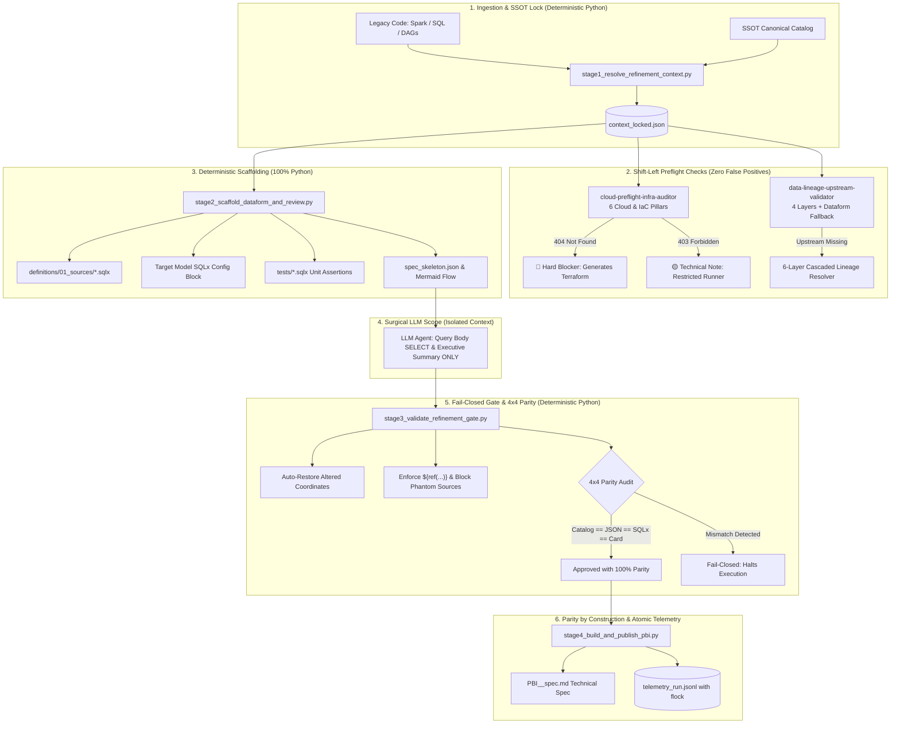

# 🚀 Autonomous Data Platform Modernization Suite
### Enterprise AI Agent Skills: Databricks (Spark / Delta) ➔ GCP BigQuery + Dataform + Airflow

[](#-solution-architecture)
[](#)
[](#)
[](#)
[](#)

---

## 📌 Executive Summary & Engineering Motivation

Modernizing thousands of legacy data pipelines from a **Databricks (Spark / Delta Lakehouse)** environment to a serverless, cloud-native architecture on **Google Cloud Platform (BigQuery + Dataform + Cloud Composer / Airflow)** is one of the most demanding enterprise engineering initiatives.

### The Genesis: Why This Suite Was Built
This repository represents the architectural evolution of a real-world enterprise modernization program. The direct motivation was **replacing an initial automation chain consisting of ~10 agent skills based purely on prompt-chaining and LLMs**.

In the initial implementation, delegating infrastructure preflight, lineage resolution, and SQLx generation entirely to LLM prompts revealed catastrophic production failure modes:
1. **Prompt-Chaining Latency & Cost:** Chaining 10 LLM invocations generated massive token consumption (35k–60k tokens per specification) and execution timeouts (6 to 12 minutes per pipeline).
2. **Coordinate & Source Hallucinations:** LLMs frequently modified or hallucinated GCP project IDs, BigQuery dataset names, or column projections (e.g., transforming `raw_customers` into `raw_customers_v1` or mapping it to the wrong cloud project), breaking Dataform compilations.
3. **False Blockers from IAM Blindness:** The prompt-based agent could not distinguish between a missing cloud asset (`404 Not Found`) and restricted local runner permissions (`403 Forbidden`), halting the backlog triage.
4. **Document vs. Code Desynchronization:** Documentation cards (Jira/Azure DevOps) frequently diverged from the actual `.sqlx` code generated, creating lingering technical debt.

To solve this at the root, the architecture was re-engineered around the **`.py`-First + Surgical LLM** paradigm. In this approach:
- **100% of discovery, infrastructure inspection, lineage graph resolution, scaffolding, and parity verification is executed by deterministic Python tools.**
- **The LLM is strictly isolated to the surgical scope of business SQL transformation logic (`SELECT ...`) and writing executive summaries.**

> [!NOTE]
> **Empirical Real-World Benchmark:** All performance metrics, token savings, and parity numbers reported below are **empirical measurements** captured during an enterprise Databricks ➔ GCP modernization program, benchmarked directly against the previous 10 pure-LLM skills baseline.

---

## 🏛️ Solution Architecture: The `.py`-First + Surgical LLM Paradigm



---

## 💥 The Real Engineering Problems in Scale Modernization

When migrating large lakehouses (1,000+ tables and ETL jobs), prompt-only AI architectures fail systematically:

1. **Cloud Coordinate Hallucination:** LLMs alter schema paths, datasets, or table names, causing failed Dataform compilations and broken downstream DAGs.
2. **Doc-to-Code Desynchronization:** Agile task cards document one set of upstream tables, while the generated code reads from different sources.
3. **Triage Halting from IAM Blindness:** Automation runners fail on permission checks (`403 Forbidden`) and falsely classify resources as missing, paralyzing migration squads.
4. **Phantom Development from Unmapped Upstreams:** Developers spend sprint time coding models before realizing that upstream tables do not yet exist in the modern data warehouse.
5. **Prompt-Chaining Brittleness:** Multi-stage prompt pipelines accumulate stochastic drift, high token costs, and compounding latency.

---

## 📈 Practical Production Impact (Empirical Benchmark: Databricks ➔ GCP)

The metrics below represent real-world results measured on an enterprise migration pipeline:

| Engineering Dimension | Previous Baseline (10 Pure-LLM Skills) | New Architecture (`.py`-First + Surgical LLM) | Measured Impact |
| :--- | :--- | :--- | :--- |
| **Pipeline Consolidation** | Fragile chain of **10 sequential prompt-dependent skills** | **3 unified skills** driven by 4 deterministic Python stages | **60% reduction in stages & failure surface** |
| **Token Consumption** | 35k to 60k tokens per specification (inflated prompts) | **~10k to 14k tokens** (context strictly isolated to `SELECT`) | **~70% cost reduction in model inference** |
| **Refinement Latency** | 6 to 12 minutes per pipeline specification | **45 to 90 seconds** (sub-second `.py` logic + single LLM call) | **~8x speedup in specification throughput** |
| **Coordinate Parity** | 15% to 30% of specs had discrepancies with SQLx | **0% (100% Parity by Construction via `context_locked.json`)** | **Zero rework from hallucinated coordinates** |
| **Cloud Audit Accuracy** | Frequent false blockers caused by local 403 errors | **Deterministic classification: `404` (MISSING) vs `403` (RESTRICTED)** | **Zero false positives & zero false negatives** |
| **SRE / IaC Shift-Left** | Missing IAM/datasets only discovered at deployment | **Automated Terraform & CLI remediation generated in preflight** | **Infrastructure resolved before engineering begins** |
| **Wave Migrations** | Hard block if the physical table was not yet in DW | **Contract fallback via merged Dataform repo (`DATAFORM_VALIDATED`)** | **Continuous parallel wave execution** |

---

## 🧰 The 3 Agent Skills Suite

```
skills/
├── cloud-preflight-infra-auditor/       # Cloud & IaC Readiness Auditor (6 Pillars)
├── data-lineage-upstream-validator/     # Upstream Lineage Auditor (4 Layers & 6-Layer Cascaded Resolver)
└── migration-spec-refiner/              # Spec Refinement Orchestrator (.py-First Architecture)
```

---

### 1. `cloud-preflight-infra-auditor`
*Preventive infrastructure readiness and cloud audit across 6 pillars before refinement or deployment.*

- **Pillar 1 — Cloud Projects, Service Accounts & Smoke Query:** Asserts `ACTIVE` state across Target (`acme-dwh-prod`), Upstream (`acme-lakehouse-raw`), Secrets, and Staging projects; validates Service Account status; runs a live BigQuery `SELECT 1` smoke query to verify APIs, billing, and job creation quotas (`bigquery.jobs.create`).
- **Pillar 2 — Datasets & Cross-Project IAM ACLs:** Inspects data tiers (`bronze_*`, `silver_*`, `gold_*`, `staging_*`) and checks cross-project IAM read policies (`roles/bigquery.dataViewer`). Emits copyable **Terraform (`google_bigquery_dataset_iam_member`)** and CLI commands for automated remediation.
- **Pillar 3 — Secret Manager & Archetype Governance:** Pure SQL transformation pipelines (Dataform ELT) execute inside BigQuery without runtime vault credentials. Secret references are classified as non-blocking warnings. Ingestion/Egress pipelines require an active secret with an `ENABLED` version.
- **Pillar 4 — Object Storage (GCS Buckets) & Tiering:** Verifies physical GCS buckets and enforces layer separation: managed lakehouse storage (Iceberg/Parquet with object versioning) vs. ephemeral staging buckets (14-day auto-deletion lifecycle).
- **Pillar 5 — External Sources (Drive/Sheets), Git Repos & DML Targets:** Executes probe query (`SELECT 1 ... LIMIT 1`) on external spreadsheet tables to catch `403 Drive credentials` errors, generating SA sharing instructions. Validates target Git repositories and pre-creates DML-only (`MERGE`) target tables.
- **Pillar 6 — Network Connectivity (VPC, Cloud NAT & Egress):** Scans JDBC/API endpoints, executes socket handshakes from sandbox runners, and discovers the outbound Cloud NAT IP for enterprise firewall whitelisting.
- **Deterministic Matrix:** Distinguishes `404 Not Found` (`🔴 MISSING_INFRA` - blocking) from `403 Forbidden` on the operator runner (`🟡 EXISTS_RESTRICTED_RUNNER` - non-blocking technical note).

#### Quick CLI Execution:
```bash
python3 skills/cloud-preflight-infra-auditor/scripts/audit_orchestrator.py \
  --manifest skills/cloud-preflight-infra-auditor/examples/sample_manifest.json \
  --dry-run \
  --output-md /tmp/preflight_report.md
```

---

### 2. `data-lineage-upstream-validator`
*Deep upstream data lineage audit with a 6-layer cascaded legacy lineage resolution engine.*

- **Strict Read vs. Write Extraction:** Extracts lineage boundaries without false positives, supporting pure external ingestion flows (JDBC/APIs) with zero upstream data warehouse tables.
- **Layer 1 (Live Data Warehouse):** Checks physical existence, row counts (`num_rows`), and partition timestamps in BigQuery.
- **Layer 2 (Dataform Repository Fallback in Waves):** For wave-based modernization, if a table is not yet in production but its `.sqlx` declaration is merged into the default branch, the skill clears the pipeline (`DATAFORM_VALIDATED`). The `is_draft_workspace` guardrail blocks unmerged local drafts (`UNSTARTED_PREDECESSOR`).
- **Layer 3 (6-Layer Cascaded Legacy Lineage Resolver):** When an upstream table is physically missing, this engine cascades through 6 resolution layers:
  1. *Recursive View Expansion* (Hive / Spark SQL / Trino views)
  2. *Orchestration Job Graphs* (Airflow, Oozie DAGs)
  3. *Parameterized Ingestion Templates* (CDC / generic framework configurations)
  4. *Target Catalog Match with Recurring Writer Scoring*
  5. *Static Code Metadata* (YAML / JSON manifests)
  6. *AST & Regex Write Scanner* (`.saveAsTable`, `INSERT INTO`, `MERGE INTO`, `CREATE TABLE`)
- **Layer 4 (Agile Task Graph & Backlog Auditor):** Matches the discovered legacy producer job to the migration board (Jira/Azure DevOps), pinpointing the exact predecessor ticket to prioritize and detecting link anomalies (*inverted dependencies*, *orphan predecessors*, or *false generic orchestrator links*).

#### Quick CLI Execution:
```bash
python3 skills/data-lineage-upstream-validator/scripts/validate_lineage.py \
  --config skills/data-lineage-upstream-validator/examples/sample_lineage_graph.json \
  --dry-run \
  --output-md /tmp/lineage_report.md
```

---

### 3. `migration-spec-refiner`
*Industrial refinement orchestrator based on the `.py`-First + Surgical LLM architecture.*

Replaces prompt-only fragility with 4 deterministic Python stages:

1. **`stage1_resolve_refinement_context.py` (SSOT Lock & Preflight):** Resolves authoritative coordinates from canonical dictionaries and freezes them into an immutable `context_locked.json` artifact before invoking any model.
2. **`stage2_scaffold_dataform_and_review.py` (Deterministic Scaffolding):** Generates 100% via Python:
   - External declarations: `definitions/01_sources/*.sqlx`
   - Target model headers: `config {}` with unique keys, partitioning, clustering, and tags
   - Quality unit assertions: `tests/assert_unique_*.sqlx`
   - Mermaid lineage architecture flow
   - A surgical prompt restricting the LLM strictly to translating the `SELECT` query body.
3. **`stage3_validate_refinement_gate.py` (Fail-Closed Gate & 4x4 Parity):** Auto-restores any coordinates modified by the LLM, validates anti-patterns (such as hardcoded GCP projects in SQL), and audits **4x4 Parity**:
   $$\text{SSOT Catalog} \equiv \text{Specification JSON} \equiv \text{Compiled SQLx Graph} \equiv \text{Agile Work Item}$$
4. **`stage4_build_and_publish_pbi.py` (Parity by Construction & Atomic Telemetry):** Assembles the finalized technical specification (`PBI_<ID>_spec.md`) from the same in-memory canonical object (zero divergence by construction) and writes telemetry logs with file-locking concurrency (`fcntl.flock` and `os.replace`).

#### Quick CLI Execution:
```bash
python3 skills/migration-spec-refiner/scripts/refiner_pipeline.py \
  --ticket-id MIG-502 \
  --target-table dim_customer_enriched \
  --catalog skills/migration-spec-refiner/examples/canonical_catalog.json \
  --output-dir /tmp/refinement_artifacts \
  --dry-run
```

---

## 📂 Repository Layout

```
.
├── README.md                                    # Executive architecture and benchmark documentation
└── skills/
    ├── cloud-preflight-infra-auditor/
    │   ├── SKILL.md                             # Agent specification and runbooks
    │   ├── scripts/
    │   │   ├── __init__.py
    │   │   ├── audit_orchestrator.py            # Unified 6-pillar preflight CLI
    │   │   ├── pillar1_projects_sa.py           # Projects, SAs, and BigQuery smoke query
    │   │   ├── pillar2_datasets_iam.py          # Datasets by tier & cross-project IAM ACLs
    │   │   ├── pillar3_secret_manager.py        # Secret Manager governance by archetype
    │   │   ├── pillar4_object_storage.py        # GCS buckets & Lakehouse tier separation
    │   │   ├── pillar5_external_sources.py      # Google Drive probes, Git repos & DML tables
    │   │   ├── pillar6_network_connectivity.py  # Network handshakes & Cloud NAT IP discovery
    │   │   └── reporters.py                     # Standardized 3-tier executive reporting engine
    │   └── examples/
    │       ├── sample_manifest.json             # Corporate preflight input manifest
    │       └── sample_report.md                 # Sample executive readiness report
    ├── data-lineage-upstream-validator/
    │   ├── SKILL.md                             # Agent specification and wave fallback logic
    │   ├── scripts/
    │   │   ├── __init__.py
    │   │   ├── validate_lineage.py              # Lineage orchestrator CLI
    │   │   ├── source_target_extractor.py       # Strict read vs. write lineage extractor
    │   │   ├── dataform_contract_checker.py     # Live DW checks & Dataform wave fallback
    │   │   ├── resolve_legacy_lineage.py        # 6-layer cascaded legacy lineage resolver
    │   │   └── backlog_task_auditor.py          # Backlog dependency graph & anomaly auditor
    │   └── examples/
    │       ├── legacy_pipeline_sample.py        # Reference PySpark pipeline
    │       ├── sample_lineage_graph.json        # Lineage configuration example
    │       └── sample_backlog.json              # Task dependency graph example
    └── migration-spec-refiner/
        ├── SKILL.md                             # .py-First architectural specification
        ├── scripts/
        │   ├── __init__.py
        │   ├── refiner_pipeline.py              # 4-stage master refinement pipeline
        │   ├── stage1_resolve_refinement_context.py
        │   ├── stage2_scaffold_dataform_and_review.py
        │   ├── stage3_validate_refinement_gate.py
        │   └── stage4_build_and_publish_pbi.py
        └── examples/
            ├── canonical_catalog.json           # Canonical SSOT dictionary
            ├── sample_legacy_spark_query.sql    # Legacy Spark SQL query
            └── sample_target_spec.json          # Compiled target model reference
```

---

## 🔒 Compliance & Sanitization

All code, schemas, and configurations strictly adhere to corporate sanitization guidelines:
- **Canonical Generic Domain:** Uses synthetic conventions such as `acme-data-platform`, `acme-dwh-prod`, and `acme-lakehouse-raw`.
- **Zero Secrets or Credentials:** Contains no real tokens, service account keys, passwords, or customer references.
- **Portability:** Runs out-of-the-box locally with `--dry-run` or against live GCP environments via standard Application Default Credentials (`gcloud auth application-default login`).

---

## 👨‍💻 Author Profile

Engineered by a **Staff Data Platform & AI Engineer** specializing in large-scale data system reliability, Governance-as-Code, and autonomous AI agents for modern analytics engineering.
