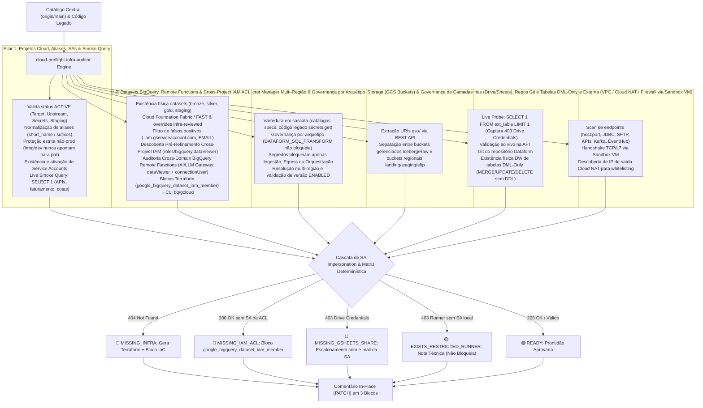

# 🛡️ Cloud Preflight Infrastructure Auditor

Skill de auditoria preventiva de prontidão de infraestrutura Cloud/IaC (6 pilares) que roda tanto **antes do refinamento técnico** (lendo o catálogo central em `origin/main` e o código legado) quanto **durante/após o refinamento e desenvolvimento** (validando com lógica `AND` o que está na especificação, nos `.sqlx` E na cascata soberana de catálogos).



---

## 🏛️ Os 6 Pilares de Prontidão de Infraestrutura

### Pilar 1 — Projetos Cloud, Normalização de Aliases, Service Accounts e Smoke Query
- **Status `ACTIVE` de Projetos:** Verifica se todos os projetos envolvidos (Target, Upstream Sources, Regional Secrets e Staging/Backfill) estão ativos na API do Google Cloud Resource Manager.
- **Normalização de Aliases IaC:** Resolve aliases históricos de nomenclatura IaC (`short_name`, mapeamento de sufixos legados e consolidação de estágios de governança para projetos ativos reais, ex: `raw` ➔ `acme-lakehouse-raw-prod`, `dwh` ➔ `acme-dwh-prod`).
- **Proteção Estrita de Ambientes Não-Produtivos:** Garante rigorosamente que ambientes de homologação/desenvolvimento (`hmg`, `dev`, `uat`) nunca apontem acidentalmente para projetos ou datasets de produção (`prd`).
- **Service Accounts Regionais:** Valida existência e estado ativo das Service Accounts regionais de ingestão e execução (ex: `sa-dataform-executor@...`).
- **Live Smoke Query no BigQuery:** Executa uma query de fumaça ao vivo (`SELECT 1 AS live_smoke_probe`) para validar se a API do BigQuery está habilitada, a conta de faturamento está vinculada e há cotas de jobs (`bigquery.jobs.create`).

### Pilar 2 — Datasets BigQuery, Remote Functions (AI/LLM Gateway) & Auditoria Cross-Project IAM ACL
- **Existência Física dos Datasets:** Verifica datasets em todas as camadas (`bronze_*`, `silver_*`, `gold_*`, `staging_*`), reconhecendo convenções pré- e pós-modernização IaC (ex: Cloud Foundation Fabric / FAST).
- **Overrides de Revisão Manual:** Respeita anotações de infraestrutura aprovada (`infra-reviewed`).
- **Filtro de Falsos Positivos de Regex:** Descarta automaticamente tokens que não são tabelas/datasets, tais como sufixos `.iam.gserviceaccount.com` ou destinos de egress como `NA`, `EMAIL`, `SFTP`, `WEBHOOK`.
- **Descoberta Pré-Refinamento de Cross-Project IAM:** Cruza o grafo de dependências e metadados estáticos mesmo antes de existirem arquivos `.sqlx`. Quando `source_project != target_project`, inspeciona ao vivo a ACL do dataset (`datasets.get` / `getIamPolicy`) para assegurar que a Service Account consumidora possua `roles/bigquery.dataViewer` (diretamente ou herdada via Google Group).
- **Auditoria Cross-Domain de BigQuery Remote Functions (AI/LLM Gateway):** Quando o pipeline invoca funções remotas de inferência ou LLM de outro domínio, valida simultaneamente a permissão de leitura no dataset compartilhado (`roles/bigquery.dataViewer`) e o vínculo de uso na conexão Cloud Resource (`roles/bigquery.connectionUser`).
- **Geração Automática de Terraform e CLI:** Emite blocos prontos de Terraform (`google_bigquery_dataset_iam_member`) e comandos CLI (`gcloud projects add-iam-policy-binding` / `bq add-iam-policy-binding`), além de síntese agrupada pronta para o time de SRE/IaC.

### Pilar 3 — Secret Manager Multi-Região & Governança por Arquétipo
- **Varredura em Cascata:** Mapeia referências a segredos em catálogos canônicos, especificações técnicas e código legado (`secrets.get`, `.yaml`, `.py`).
- **Governança por Arquétipo:** Pipelines puramente de transformação SQL no DW (`DATAFORM_SQL_TRANSFORM`) operam dentro da engine do BigQuery sem acesso direto a cofres externos no runtime; nesses casos, referências a segredos geram alertas sem bloquear o pipeline. Bloqueios estritos aplicam-se apenas a Ingestão, Egress ou Orquestradores externos (Airflow/Cloud Run).
- **Resolução Multi-Região & Versão Ativa:** Suporta resolução por nome exato e prefixos regionais (`southamerica-east1`, `us-central1`), garantindo que haja ao menos uma versão `ENABLED`.

### Pilar 4 — Object Storage (GCS Buckets) & Governança de Camadas
- **Extração de URIs `gs://`:** Identifica buckets configurados no código legado e valida existência física via REST API.
- **Separação de Camadas:** Impõe distinção arquitetural entre buckets dedicados a tabelas gerenciadas de lakehouse (Apache Iceberg / Delta Lake com versionamento ativo) e buckets regionais transitórios dedicados a *landing / staging / egress / SFTP* (com regras de ciclo de vida de expiração configuradas).

### Pilar 5 — Fontes Externas (Drive/Sheets), Repositórios Git e Tabelas DML-Only
- **Live Probe de Google Sheets:** Executa leitura real (`SELECT 1 FROM <external_table> LIMIT 1`) em External Tables baseadas no Google Sheets para capturar erros reais `403 Permission denied while getting Drive credentials`, gerando imediatamente o bloco de escalonamento com o e-mail exato da Service Account de ingestão para compartilhamento da planilha.
- **Validação ao Vivo de Repositórios Git:** Verifica na API do Git (GitHub, GitLab, Azure Repos) se o repositório Dataform de destino existe e tem branches acessíveis.
- **Tabelas DML-Only:** Para tabelas operadas exclusivamente via DML (`type: "operations"` contendo `MERGE`, `UPDATE` ou `DELETE` sem DDL `CREATE TABLE`), valida se já existem fisicamente no DW, ignorando alvos descartados (`discarded_by`) ou de camadas de aplicação.

### Pilar 6 — Conectividade de Rede Externa (VPC / Cloud NAT / Firewall via Sandbox VM)
- **Identificação de Endpoints Externos:** Detecta endpoints remotos (`host:port`, JDBC, SFTP, APIs REST, Kafka, EventHub) a partir do código e assinaturas de conexão.
- **Handshake e Sandbox VM:** Quando acionado ou com VM Sandbox regional ativa, executa teste de handshake TCP / Layer 7.
- **Cloud NAT Egress Discovery:** Descobre o IP público de saída do Cloud NAT e gera a solicitação padronizada de *firewall whitelist* para o time de redes/segurança.

---

## 🎯 Cascata de Impersonation & Matriz Zero Falso Positivo / Zero Falso Negativo

| Cenário de Diagnóstico | Código de Status | Ação no Pipeline | Classificação |
| :--- | :--- | :--- | :--- |
| **Recurso não existe no GCP** | `404 Not Found` | Bloqueia refinamento (`🔴 MISSING_INFRA`) | Bloqueio real (IaC pendente) |
| **Dataset existe, mas SA não está na ACL** | `200 OK` (sem SA) | Bloqueia refinamento (`🔴 MISSING_IAM_ACL`) | Bloqueio real (Gera Terraform) |
| **Planilha Drive sem permissão para SA** | `403 Drive Credentials` | Bloqueia refinamento (`🔴 MISSING_GSHEETS_SHARE`) | Bloqueio real (Gera e-mail da SA) |
| **Runner local sem permissão, mas recurso existe** | `403 Forbidden` no Runner | Prossegue refinamento com nota (`🟡 EXISTS_RESTRICTED_RUNNER`) | **Zero Falso Positivo** |
| **Permissão herdada por Google Group** | `200 OK via Group` | Prossegue refinamento (`🟡 GROUP_ACL_VERIFIED_OR_NOTE`) | **Zero Falso Positivo** |
| **VM Sandbox offline para teste de rede** | Timeout / Offline | Prossegue com nota (`🟡 SKIPPED_SANDBOX_OFFLINE`) | Não bloqueia esteira |

### Comentário Executivo Padronizado em 3 Blocos (In-Place via `PATCH`)
1. **`📌 Bloco 1: Resumo`**: Diagnóstico consolidado da prontidão, semáforo executivo e tabela de recursos avaliados.
2. **`🎯 Bloco 2: Ao time de Infraestrutura (IaC / SRE)`**: Blocos de código prontos em Terraform HCL, comandos CLI (`gcloud`/`bq`) e instruções de permissão de Service Account.
3. **`🔬 Bloco 3: Análise complementar dos 6 Pilares`**: Tabela detalhada de cada um dos 6 pilares com latência, status de resposta e evidência auditável.

---

## 🛠️ CLI Execution & Usage

### 1. Auditoria Pré-Refinamento (Catálogo origin/main + Código Legado)
```bash
python3 skills/cloud-preflight-infra-auditor/scripts/audit_orchestrator.py \
  --manifest skills/cloud-preflight-infra-auditor/examples/sample_manifest.json \
  --phase pre_refinement \
  --output-md /tmp/preflight_report.md \
  --fail-on-blocker
```

### 2. Auditoria Pós-Refinamento (Lógica AND: Spec + SQLx + Catálogos)
```bash
python3 skills/cloud-preflight-infra-auditor/scripts/audit_orchestrator.py \
  --manifest skills/cloud-preflight-infra-auditor/examples/sample_manifest.json \
  --phase post_refinement \
  --output-md /tmp/post_refinement_report.md
```

### 3. Modo Dry-Run / Teste Local sem Chamadas de Nuvem
```bash
python3 skills/cloud-preflight-infra-auditor/scripts/audit_orchestrator.py \
  --manifest skills/cloud-preflight-infra-auditor/examples/sample_manifest.json \
  --dry-run \
  --output-md /tmp/simulated_preflight.md
```
