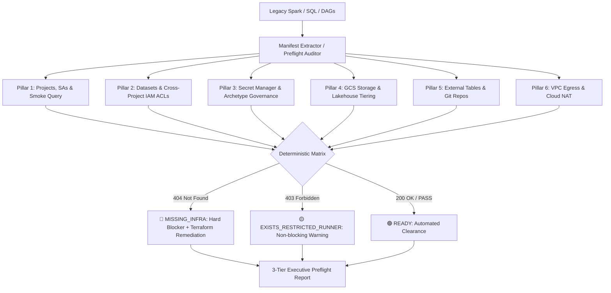

# Cloud Preflight Infrastructure Auditor

A deterministic cloud infrastructure readiness and pre-flight auditing skill for modern data platform migrations (Legacy Spark / Hadoop / On-Prem Data Lakehouse to **GCP BigQuery + Dataform + Airflow**).

This skill performs a rigorous, 6-pillar inspection **before** technical refinement starts (extracting requirements from legacy metadata, queries, and DAGs) and **after** specification generation (validating work item cards against live cloud assets).



---

## 🏛️ The 6 Pillars of Preflight Readiness

### Pillar 1: Cloud Projects, Service Accounts & Smoke Query
- **Target & Upstream Projects:** Verifies `ACTIVE` status on Target (`acme-dwh-prod`), Upstream (`acme-lakehouse-raw`), Secrets, and Staging GCP projects.
- **Service Accounts:** Validates existence and active state of workload runner identities (e.g., `sa-dataform-executor@acme-dwh-prod.iam.gserviceaccount.com`).
- **Live Smoke Query:** Executes a live probe (`SELECT 1`) on BigQuery to guarantee APIs are enabled, billing is active, and compute job quotas (`bigquery.jobs.create`) are healthy.

### Pillar 2: Datasets & Cross-Project IAM ACL Audit
- **Lakehouse Tiers:** Asserts physical existence of dataset boundaries (`bronze_*`, `silver_*`, `gold_*`, `staging_*`).
- **Cross-Project IAM:** When pipelines consume data across project boundaries, inspects dataset IAM policies (`roles/bigquery.dataViewer`).
- **Auto-Remediation:** If missing, generates exact Terraform resources (`google_bigquery_dataset_iam_member`) and `bq add-iam-policy-binding` commands.

### Pillar 3: Secret Manager & Archetype Governance
- **Archetype Awareness:** Pure SQL transformation pipelines (Dataform / BigQuery ELT) execute inside BigQuery without runtime vault credentials. Secret references in SQL are classified as architectural anti-patterns or non-blocking warnings.
- **Ingestion / Egress Pipelines:** Enforces strict requirement: secrets must exist and have at least one `ENABLED` secret version.

### Pillar 4: Object Storage (GCS) & Layer Governance
- **Bucket Extraction:** Discovers `gs://` URIs across legacy Spark configurations.
- **Tier Separation:** Enforces separation between managed lakehouse tables (Apache Iceberg, Parquet lakehouses with versioning enabled) and landing/staging buckets (ephemeral storage with automated 14-day lifecycle deletion rules).

### Pillar 5: External Sources (Drive/Sheets), Git Repos & DML Targets
- **Google Drive / Sheets 403 Probe:** Runs a live `SELECT 1 FROM ext_table LIMIT 1` probe to catch missing Google Drive OAuth permissions before pipeline execution. Outputs step-by-step sheet sharing instructions for the Service Account.
- **Target Git Repository:** Verifies Git repository access and remote branch availability.
- **DML-Only Tables:** Detects target tables populated exclusively by `MERGE`, `UPDATE`, or `DELETE`, ensuring physical tables are pre-created via DDL before pipeline execution.

### Pillar 6: External Network Connectivity (VPC, Cloud NAT & Egress)
- **Endpoint Discovery:** Scans legacy code for external endpoints (`host:port`, JDBC URLs, SFTP, APIs, Kafka).
- **Network Handshake:** Performs socket-level TCP handshakes to confirm reachability from Cloud Sandbox / Composer runners.
- **Cloud NAT Egress Whitelisting:** Resolves public outbound Cloud NAT IP and formats firewall whitelist requests for security/network operations teams.

---

## 🎯 Deterministic Matrix (Zero False Positives / Zero False Negatives)

A major failure mode in automated modernization pipelines is failing runs due to operator permissions rather than infrastructure absence. This skill implements a deterministic classification:

| Cloud Response | Classification | Engine Decision | Action Taken |
| :--- | :--- | :--- | :--- |
| **`404 Not Found`** | `🔴 MISSING_INFRA` | **Hard Blocker (NO-GO)** | Resource physically does not exist in Cloud. Halts refinement and outputs copyable Terraform IaC to provision it. |
| **`403 Forbidden`** | `🟡 EXISTS_RESTRICTED_RUNNER` | **Non-blocking Warning** | The resource exists, but the operator's runner account has limited IAM scope. Refinement proceeds without halting the migration backlog. |
| **`200 OK / Enabled`**| `🟢 PASS` | **Clearance (GO)** | Verified healthy and available in target environment. |

---

## 🛠️ CLI Execution & Usage

### Running an Audit via CLI
```bash
python3 skills/cloud-preflight-infra-auditor/scripts/audit_orchestrator.py \
  --manifest /path/to/pipeline_manifest.json \
  --output-md /path/to/preflight_report.md \
  --output-json /path/to/preflight_report.json \
  --fail-on-blocker
```

### Dry-Run Mode (Local Simulation & CI Validation)
```bash
python3 skills/cloud-preflight-infra-auditor/scripts/audit_orchestrator.py \
  --manifest skills/cloud-preflight-infra-auditor/examples/sample_manifest.json \
  --dry-run \
  --output-md /tmp/preflight_report.md
```

---

## 📋 Input Manifest Schema (`pipeline_manifest.json`)

```json
{
  "pipeline_name": "customer-360-feature-mart",
  "archetype": "SQL_TRANSFORMATION",
  "projects": {
    "target": "acme-dwh-prod",
    "upstream": "acme-lakehouse-raw",
    "secrets": "acme-security-vault",
    "staging": "acme-sandbox-tmp"
  },
  "service_accounts": [
    "sa-dataform-executor@acme-dwh-prod.iam.gserviceaccount.com"
  ],
  "datasets": [
    {
      "project_id": "acme-dwh-prod",
      "dataset_id": "gold_customer_analytics",
      "layer": "gold"
    },
    {
      "project_id": "acme-lakehouse-raw",
      "dataset_id": "bronze_erp_customers",
      "layer": "bronze"
    }
  ],
  "buckets": [
    {
      "bucket_name": "acme-lakehouse-raw-iceberg-data",
      "layer_purpose": "ICEBERG_WAREHOUSE",
      "project_id": "acme-lakehouse-raw"
    }
  ],
  "secrets": [
    {
      "secret_name": "sftp-legacy-extract-key",
      "project_id": "acme-security-vault"
    }
  ],
  "external_tables": [
    {
      "project_id": "acme-dwh-prod",
      "dataset_id": "bronze_manual_sources",
      "table_id": "ext_territory_mapping",
      "source_type": "GOOGLE_SHEETS",
      "drive_uri": "https://docs.google.com/spreadsheets/d/EXAMPLE/edit"
    }
  ],
  "dml_target_tables": [
    {
      "project_id": "acme-dwh-prod",
      "dataset_id": "gold_customer_analytics",
      "table_id": "dim_customer_scd2"
    }
  ],
  "network_endpoints": [
    {
      "name": "Legacy Oracle CRM",
      "host": "oracle-crm.internal.acme.corp",
      "port": 1521,
      "protocol": "JDBC"
    }
  ],
  "git_repo_url": "https://github.com/acme-data-platform/dataform-core-warehouse.git"
}
```

---

## 📦 Output Artifacts

The orchestrator produces a standardized 3-section report:
1. **Executive Readiness Summary:** High-level GO / NO-GO status, blocker counts, and archetype context.
2. **IaC / SRE Auto-Remediation Playbook:** Ready-to-copy Terraform definitions (`google_bigquery_dataset_iam_member`, `google_storage_bucket`, `google_secret_manager_secret`) and CLI remediation commands.
3. **Technical Evidence Matrix:** Tabular evidence across all 6 evaluated pillars.
