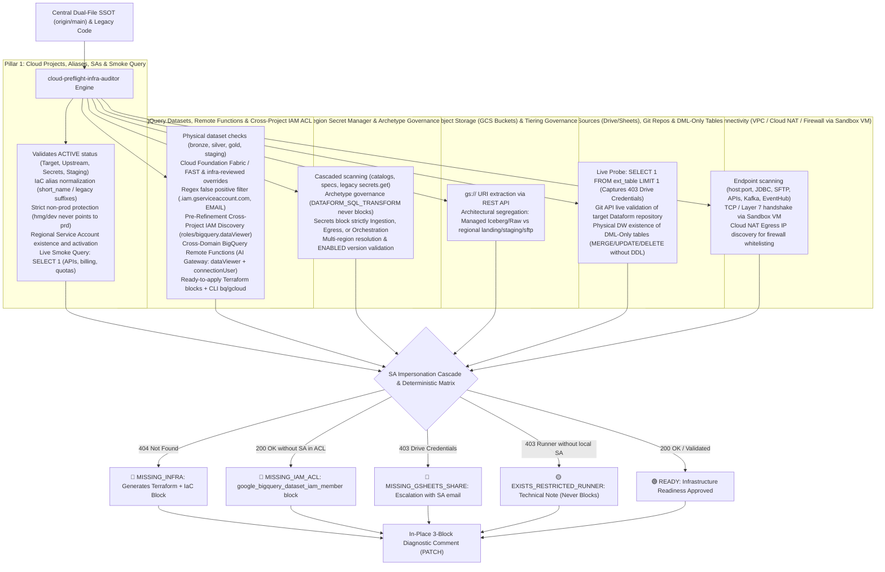

# 🛡️ Cloud Preflight Infrastructure Auditor

Preventive Cloud & IaC infrastructure readiness audit skill across **6 critical pillars**. Executes both **prior to technical refinement** (reading exclusively from the central Dual-File SSOT catalog in `origin/main` and legacy source code) and **during/after refinement and development** (validating with strict `AND` logic across the specification, generated `.sqlx` artifacts, and canonical catalogs).



---

## 🏛️ The 6 Infrastructure Readiness Pillars

### Pillar 1 — Cloud Projects, Alias Normalization, Service Accounts & Smoke Query
- **`ACTIVE` Project Status:** Verifies that all involved GCP projects (Target, Upstream Sources, Regional Secrets, and Staging/Backfill) are active in Google Cloud Resource Manager.
- **IaC Alias Normalization:** Resolves historical IaC naming aliases (`short_name`, legacy suffix mappings, and domain acronym exceptions; e.g., `raw` ➔ `acme-lakehouse-raw-prod`, `dwh` ➔ `acme-dwh-prod`).
- **Strict Non-Production Protection:** Strictly enforces that non-production environments (`hmg`, `dev`, `uat`) never point to production coordinates (`prd`), redirecting staging/homologation to development targets.
- **Regional Service Accounts:** Validates existence and activation of regional ingestion and processing Service Accounts (e.g., `sa-dataform-executor@...`).
- **Live Smoke Query in BigQuery:** Executes a live smoke query (`SELECT 1 AS live_smoke_probe`) to confirm that BigQuery API is enabled, billing is linked, and job quotas exist (`bigquery.jobs.create`).

### Pillar 2 — BigQuery Datasets, Remote Functions (AI/LLM Gateway) & Cross-Project IAM ACL
- **Physical Dataset Verification:** Inspects physical datasets across all layers (`bronze_*`, `silver_*`, `gold_*`, `staging_*`), supporting pre- and post-modernization conventions (Cloud Foundation Fabric / FAST).
- **Manual Review Overrides:** Honors approved infrastructure annotations (`infra-reviewed`).
- **Regex False-Positive Filtering:** Automatically ignores non-dataset tokens such as `.iam.gserviceaccount.com` or non-table egress endpoints (`NA`, `EMAIL`, `SFTP`, `WEBHOOK`).
- **Pre-Refinement Cross-Project IAM Discovery:** Cross-references dependency graphs and static metadata before `.sqlx` files exist. When `source_project != target_project`, inspects dataset ACLs (`datasets.get` / `getIamPolicy`) to guarantee the consumer SA possesses `roles/bigquery.dataViewer` (directly or inherited via Google Groups).
- **Cross-Domain BigQuery Remote Functions (AI/LLM Gateway):** When pipelines invoke remote inference/LLM functions from another domain, concurrently validates read permission on the shared dataset (`roles/bigquery.dataViewer`) and connection usage binding (`roles/bigquery.connectionUser`).
- **Automated Terraform & CLI Generation:** Generates copy-pasteable Terraform blocks (`google_bigquery_dataset_iam_member`), CLI commands (`bq`/`gcloud`), and grouped requests for SRE/IaC teams.

### Pillar 3 — Multi-Region Secret Manager & Archetype Governance
- **Cascaded Secret Scanning:** Scans secrets referenced in canonical catalogs, specifications, and legacy code (`secrets.get`, `.yaml`, `.py`).
- **Archetype Governance:** Pipelines with purely SQL DW transformation (`DATAFORM_SQL_TRANSFORM`) execute inside BigQuery without runtime vault access; in these cases, secret references generate warnings without halting the pipeline. Strict blockers apply only to Ingestion, Egress, or external orchestrators (Airflow/Cloud Run).
- **Multi-Region & Active Version Resolution:** Supports exact names and regional prefixes (`southamerica-east1`, `us-central1`), ensuring at least one version is `ENABLED`.

### Pillar 4 — Object Storage (GCS Buckets) & Tiering Governance
- **`gs://` URI Extraction:** Extracts storage URIs and validates existence via Google Cloud Storage REST API.
- **Architectural Segregation:** Enforces separation between managed lakehouse tables (Apache Iceberg / Delta Lake with object versioning) and regional staging/landing/egress/SFTP buckets (with lifecycle expiration rules).

### Pillar 5 — External Sources (Drive/Sheets), Git Repos & DML-Only Tables
- **Google Sheets Live Probe:** Executes live read (`SELECT 1 FROM <external_table> LIMIT 1`) on external tables backed by Google Sheets to intercept real `403 Permission denied while getting Drive credentials` errors, immediately generating the escalation block with the exact ingestion SA email.
- **Live Git Repository Verification:** Checks Git provider APIs (GitHub, GitLab, Azure Repos) to verify target Dataform repository existence and branch accessibility.
- **Physical DW Check for DML-Only Tables:** For tables operated strictly via DML (`type: "operations"` containing `MERGE`, `UPDATE`, or `DELETE` without DDL `CREATE TABLE`), validates physical DW existence, ignoring discarded targets (`discarded_by`) or application-layer endpoints.

### Pillar 6 — External Network Connectivity (VPC / Cloud NAT / Firewall via Sandbox VM)
- **External Endpoint Identification:** Detects external endpoints (`host:port`, JDBC, SFTP, REST APIs, Kafka, EventHub) from connection signatures.
- **TCP/Layer 7 Handshake via Sandbox VM:** Conducts network connectivity handshakes through active regional Sandbox VMs.
- **Cloud NAT Egress IP Discovery:** Discovers the public egress IP of the Cloud NAT gateway, generating ready-to-apply firewall whitelisting requests.

---

## 🎯 Impersonation Cascade & Zero False-Positive / Zero False-Negative Matrix

| Scenario | Status Code | Pipeline Action | Classification |
| :--- | :--- | :--- | :--- |
| **Resource missing in GCP** | `404 Not Found` | Halts refinement (`🔴 MISSING_INFRA`) | True Blocker (Pending IaC) |
| **Dataset exists, SA not in ACL** | `200 OK` (without SA) | Halts refinement (`🔴 MISSING_IAM_ACL`) | True Blocker (Terraform Generated) |
| **Google Sheets lacking SA share** | `403 Drive Credentials` | Halts refinement (`🔴 MISSING_GSHEETS_SHARE`) | True Blocker (Escalates with SA email) |
| **Local runner restricted, resource exists** | `403 Forbidden` on Runner | Proceeds with technical note (`🟡 EXISTS_RESTRICTED_RUNNER`) | **Zero False Positive** |
| **Permission inherited via Google Group** | `200 OK via Group` | Proceeds with note (`🟡 GROUP_ACL_VERIFIED_OR_NOTE`) | **Zero False Positive** |
| **Sandbox VM offline for network check** | Timeout / Offline | Proceeds with note (`🟡 SKIPPED_SANDBOX_OFFLINE`) | Does not block pipeline |

### Standardized 3-Block Executive Comment (In-Place via `PATCH`)
1. **`📌 Block 1: Executive Summary`**: High-level verdict, traffic light indicator, and resource inventory table.
2. **`🎯 Block 2: Infrastructure / SRE Actionable Playbook`**: Ready-to-apply Terraform HCL blocks, CLI commands (`gcloud`/`bq`), and IAM binding configurations.
3. **`🔬 Block 3: Detailed 6-Pillar Audit Analysis`**: In-depth pillar breakdown with response latencies, HTTP statuses, and audit evidence.

---

## 🛠️ CLI Execution & Usage

### 1. Pre-Refinement Audit (origin/main SSOT Catalog + Legacy Code)
```bash
python3 skills/cloud-preflight-infra-auditor/scripts/audit_orchestrator.py \
  --manifest skills/cloud-preflight-infra-auditor/examples/sample_manifest.json \
  --phase pre_refinement \
  --output-md /tmp/preflight_report.md \
  --fail-on-blocker
```

### 2. Post-Refinement Cross-Check (Strict AND Logic: Spec + SQLx + Catalogs)
```bash
python3 skills/cloud-preflight-infra-auditor/scripts/audit_orchestrator.py \
  --manifest skills/cloud-preflight-infra-auditor/examples/sample_manifest.json \
  --phase post_refinement \
  --output-md /tmp/post_refinement_report.md
```

### 3. Dry-Run / Local Simulation Mode
```bash
python3 skills/cloud-preflight-infra-auditor/scripts/audit_orchestrator.py \
  --manifest skills/cloud-preflight-infra-auditor/examples/sample_manifest.json \
  --dry-run \
  --output-md /tmp/simulated_preflight.md
```
