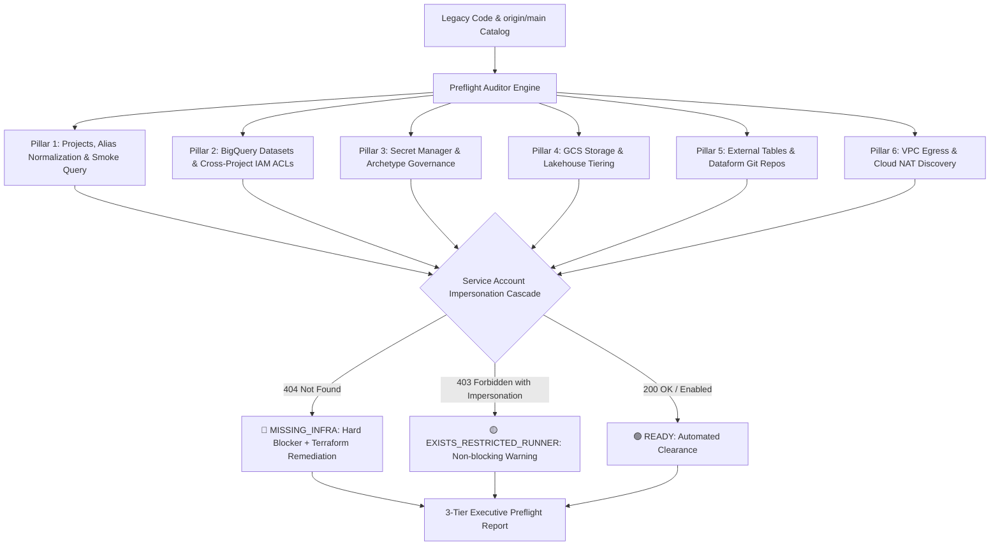

# Cloud Preflight Infrastructure Auditor

A deterministic cloud infrastructure readiness and pre-flight auditing skill for modern data platform modernizations (**Databricks / Delta Lake / Spark to GCP BigQuery + Dataform + Airflow**).

This skill performs a rigorous 6-pillar inspection across two critical lifecycle phases:
1. **Pre-Refinement:** Audits the central catalog in `origin/main` and legacy source code before engineering begins.
2. **Post-Refinement:** Enforces **AND-logic cross-validation** across: (1) Work item specification, (2) compiled `.sqlx` files, AND (3) the sovereign metadata graph.



---

## 🏛️ The 6 Pillars of Preflight Readiness

### Pillar 1: Projects, Alias Normalization, Service Accounts & Smoke Query
- **Alias Normalization:** Resolves historical IaC naming aliases (such as `raw`, `prod`, `dwh`, `vault`, `stage` or legacy suffixes) into active, authoritative GCP project IDs.
- **Active State Validation:** Confirms `ACTIVE` lifecycle state for Target (`acme-dwh-prod`), Upstream (`acme-lakehouse-raw`), Secrets, and Staging projects.
- **Service Account Status:** Asserts existence and active state of workload runner identities (e.g. `sa-dataform-executor@acme-dwh-prod.iam.gserviceaccount.com`).
- **Live Smoke Query:** Executes a live query probe (`SELECT 1 AS readiness_check`) on BigQuery to guarantee APIs are enabled, billing accounts are linked, and compute quotas (`bigquery.jobs.create`) are healthy.

### Pillar 2: BigQuery Datasets & Cross-Project IAM ACL Audit
- **Tier Verification:** Verifies physical existence of dataset boundaries (`bronze_*`, `silver_*`, `gold_*`, `staging_*`).
- **Regex False-Positive Filtering:** Automatically discards non-dataset tokens caught by naive regexes (such as `.iam.gserviceaccount.com` suffixes or egress destinations like `NA`, `EMAIL`, `SFTP`).
- **Cross-Project Dependency Check:** Inspects cross-project dependencies (`source_project != target_project`) even before `.sqlx` code is authored.
- **IAM Policy Verification:** Validates that the consumer Service Account holds `roles/bigquery.dataViewer` (directly or via an authorized Google Group).
- **Auto-Remediation:** Emits copyable Terraform resources (`google_bigquery_dataset_iam_member`) and `bq add-iam-policy-binding` CLI commands.

### Pillar 3: Secret Manager & Archetype Governance
- **Archetype Governance:** Pure SQL transformation pipelines (Dataform / BigQuery ELT) execute inside the BigQuery engine without vault credentials in runtime. Secret references are non-blocking warnings.
- **Ingestion & Egress Pipelines:** External pipelines (Airflow / Cloud Run / Dataflow) must have secrets provisioned with at least one `ENABLED` secret version.

### Pillar 4: Object Storage (GCS Buckets) & Layer Governance
- **Bucket Extraction:** Discovers `gs://` URIs across legacy PySpark configurations.
- **Tier Segregation:** Enforces segregation between managed lakehouse tables (Apache Iceberg / Parquet lakehouses with versioning enabled) and dedicated landing/staging buckets (configured with 14-day automatic deletion lifecycle rules).

### Pillar 5: External Sources (Drive/Sheets), Git Repos & DML Targets
- **Google Sheets 403 Probe:** Runs a live probe (`SELECT 1 FROM ext_table LIMIT 1`) to intercept `403 Drive credentials` errors before pipeline execution, generating step-by-step sharing instructions for the Service Account.
- **Dataform Git Repository:** Verifies Git repository access and remote branch availability via API/Git.
- **DML-Only Tables:** Detects target tables populated exclusively via `MERGE`, `UPDATE`, or `DELETE`, ensuring they are pre-created via DDL before pipeline execution.

### Pillar 6: External Network Connectivity (VPC, Cloud NAT & Egress)
- **Endpoint Discovery:** Scans code for external endpoints (`host:port`, JDBC URLs, SFTP, APIs, Kafka).
- **Network Handshake:** Performs socket-level TCP/L7 handshakes from sandbox instances.
- **Cloud NAT Egress Whitelisting:** Resolves public outbound Cloud NAT IP and formats firewall whitelist requests for enterprise SecOps/NetOps teams.

---

## 🎯 SA Impersonation Cascade & Deterministic Matrix

A critical failure mode in automated modernization pipelines is failing runs due to operator runner permissions rather than infrastructure absence:

1. **Automated Impersonation Cascade:** When the local operator runner receives `403 Forbidden` while inspecting a dataset or cloud asset, the auditor automatically attempts **Service Account Impersonation** (using the regional ingestion/processing SA via IAM Credentials API).
2. **Deterministic Matrix:**
   - **`404 Not Found` (`🔴 MISSING_INFRA`):** Hard blocker. The resource physically does not exist in the cloud. Halts refinement and outputs copyable Terraform IaC.
   - **`403 Forbidden` without local permission (`🟡 EXISTS_RESTRICTED_RUNNER`):** Non-blocking warning. The resource exists in the cloud project directory, but the local operator has restricted visibility. Refinement proceeds with an audit note.
   - **`200 OK / Enabled` (`🟢 PASS`):** Verified healthy and available in target cloud environment.

---

## 🛠️ CLI Execution & Usage

### Pre-Refinement Mode (Catalog & Legacy Code)
```bash
python3 skills/cloud-preflight-infra-auditor/scripts/audit_orchestrator.py \
  --manifest /path/to/pipeline_manifest.json \
  --phase pre_refinement \
  --output-md /path/to/preflight_report.md \
  --fail-on-blocker
```

### Post-Refinement Cross-Validation (AND-Logic with .sqlx & Spec)
```bash
python3 skills/cloud-preflight-infra-auditor/scripts/audit_orchestrator.py \
  --manifest /path/to/pipeline_manifest.json \
  --phase post_refinement \
  --sqlx-dir /path/to/dataform/definitions \
  --spec-file /path/to/spec.json \
  --impersonate-sa sa-dataform-executor@acme-dwh-prod.iam.gserviceaccount.com \
  --output-md /path/to/post_refinement_report.md
```

### Local Dry-Run Simulation
```bash
python3 skills/cloud-preflight-infra-auditor/scripts/audit_orchestrator.py \
  --manifest skills/cloud-preflight-infra-auditor/examples/sample_manifest.json \
  --dry-run \
  --output-md /tmp/preflight_report.md
```
