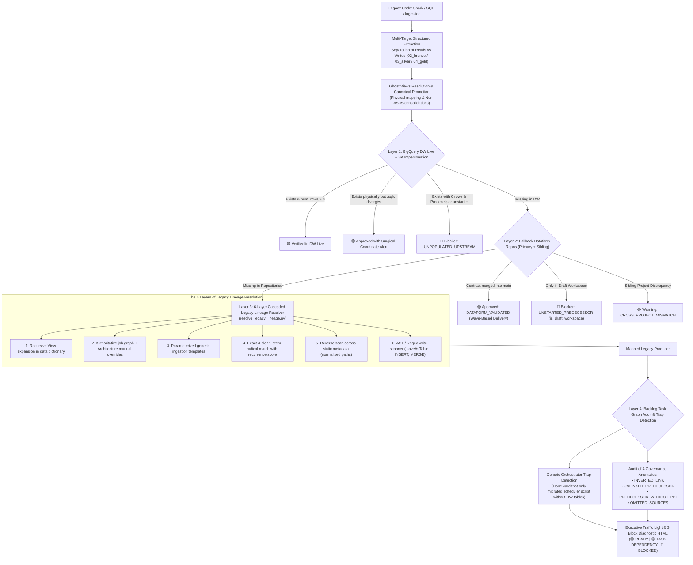

# 🔗 Data Lineage Upstream Validator

Preflight and deep audit upstream data lineage skill across **6 verification layers** to prevent phantom development — ensuring upstream source tables physically exist, contain data, contracts are synchronized, and predecessor card dependencies are mapped without ambiguity.



---

## 🏛️ Verification Pillars and Lineage Layers

### Structured Extraction, Ghost Views Resolution & Non-AS-IS Filters
- **Strict Read/Write Segregation:** Strictly separates read tables (*upstream sources*) from write targets (*target tables* in `02_bronze`, `03_silver`, `04_gold`), natively supporting multi-target pipelines and external ingestion flows (JDBC, relational databases, REST APIs without intermediate DW sources).
- **Ghost Views Resolution & Canonical Promotion:** Automatically expands legacy logical views to canonical physical batch or streaming tables, promotes raw legacy schemas to corresponding silver layers, and recognizes architectural consolidations (*Non-AS-IS*), eliminating false blockers and ghost targets.

---

### Layer 1: Data Warehouse Live + SA Impersonation + Coordinate Verification
- **Physical BigQuery Inspection:** Queries BigQuery API inspecting table existence, `num_rows`, and partition modification timestamps with automated *Service Account Impersonation* fallback.
- **Live Physical BigQuery Metadata Inspection (Wave 1):** In addition to `num_rows` and `last_modified`, directly extracts from the BigQuery API (`tables.get`) the real physical schema (`live_bq_schema`: column name, data type, and mode), real partitioning column and type (`live_partition_field`, `live_partition_type`), the `require_partition_filter` flag, and clustering keys (`clustering_fields`). Exposes this live physical metadata to safeguard `.sqlx` generation and refinement against outdated static schemas and dictionary drift.
- **Surgical `.sqlx` Coordinate Alert:** If the physical table exists at the architected coordinate but `01_sources/*.sqlx` points to a divergent project/dataset, approves the card while generating a surgical alert to adjust coordinates in `.sqlx`.
- **Empty Table Guard (`UNPOPULATED_UPSTREAM`):** If the table exists in BigQuery but contains `0 rows` (empty shell) and the producing predecessor card is not yet completed (`Pre-Wave` or `Refining`), halts progression to prevent downstream logic execution against unpopulated schemas.

---

### Layer 2: Dataform Repository Fallback + Draft Guardrail + Sibling Scanner
- **Wave-Based Modernization Approval:** In staged rollouts, if physical tables are not yet materialized in production but their `.sqlx` contract is merged into the primary Dataform repository, approves the card (`DATAFORM_VALIDATED`).
- **Draft Workspace Guardrail (`is_draft_workspace`):** Rejects contracts residing exclusively in local draft branches of unstarted predecessor cards, halting with `UNSTARTED_PREDECESSOR`.
- **Sibling Project Scanner:** Scans sibling ingestion and domain repositories to capture discrepancies between analytic and ingestion project boundaries (`CROSS_PROJECT_MISMATCH`).

---

### Layer 3: 6-Layer Cascaded Legacy Lineage Resolver (`resolve_legacy_lineage.py`)
When an upstream source is missing in BigQuery, the engine discovers which legacy routine produces it:
1. **Recursive View Expansion:** Recursively traces views in Hive, Spark SQL, and Trino to root physical tables.
2. **Authoritative Job Graph & Manual Overrides:** Navigates enterprise dependency graphs honoring architect-reviewed manual overrides.
3. **Parameterized Ingestion Templates:** Evaluates ingestion frameworks (CDC, Debezium, Sqoop, Dataflow).
4. **Exact & Clean Stem Radical Match:** Evaluates table stem naming patterns combined with recurrent writer scores.
5. **Static Metadata Reverse Scan:** Scans configuration files (YAML/JSON) supporting dictionaries, lists, and path normalizations.
6. **AST & Regex Write Scanner:** Analyzes legacy source code for explicit table writes (`.write`, `.saveAsTable`, `INSERT INTO`, `MERGE INTO`, `CREATE TABLE`), legacy orchestrator schedules, and static dimensional references.

---

### Layer 4: Backlog Task Graph Audit, Trap Detection & Executive Traffic Light
- **Generic Orchestrator Trap Detection:** Detects and flags dependencies linked to cards marked `Done` that only migrated a master orchestrator script without materializing downstream physical tables in the DW.
- **Audit of 4 Governance Anomalies:**
  1. `INVERTED_LINK`: Predecessor mistakenly assigned as successor (circular or reversed dependency).
  2. `UNLINKED_PREDECESSOR`: Physical code dependency existing in backlog without Kanban card link.
  3. `PREDECESSOR_WITHOUT_PBI`: Upstream source table with no card mapped anywhere in the backlog.
  4. `OMITTED_SOURCES`: Sources read in legacy code omitted from card technical specifications.
- **Standardized 3-Block Diagnostic Comment:**
  - `📌 Block 1: Executive Summary`: Readiness verdict and Traffic Light status.
  - `🎯 Block 2: Refinement Squad Playbook`: Exact dependency linkage instructions and priorities.
  - `🔬 Block 3: In-Depth Lineage Traceability`: Full source-to-target audit evidence.

---

## 🚦 Executive Governance Traffic Light

| Status | Semaphore | Description | Pipeline Action |
| :--- | :---: | :--- | :--- |
| **`READY`** | 🟢 | All upstream sources physically exist and are populated in the DW. | Approved for immediate development. |
| **`TASK DEPENDENCY`** | 🟡 | Legitimate dependency mapped to a predecessor card currently in progress. | Awaits predecessor completion. |
| **`CROSS-PROJECT MISMATCH`** | 🟡 | Table exists in sibling project, but local declaration points elsewhere. | Adjust `.sqlx` project coordinates. |
| **`BLOCKED / GOVERNANCE GAP`** | 🔴 | Table contains 0 rows, unmapped card (`SEM_PBI`), or inverted link. | Blocked: immediate squad escalation. |

---

## 🛠️ CLI Execution & Usage

### 1. Standard Upstream Lineage Audit
```bash
python3 skills/data-lineage-upstream-validator/scripts/validate_lineage.py \
  --config skills/data-lineage-upstream-validator/examples/sample_lineage_graph.json \
  --output-md /tmp/lineage_report.md \
  --fail-on-missing
```

### 2. With SA Impersonation & 0-Rows Lock
```bash
python3 skills/data-lineage-upstream-validator/scripts/validate_lineage.py \
  --config /path/to/lineage_config.json \
  --impersonate-sa sa-dataform-executor@acme-dwh-prod.iam.gserviceaccount.com \
  --output-md /tmp/lineage_audit.md
```

### 3. Simulated Dry-Run Mode
```bash
python3 skills/data-lineage-upstream-validator/scripts/validate_lineage.py \
  --config skills/data-lineage-upstream-validator/examples/sample_lineage_graph.json \
  --dry-run \
  --output-md /tmp/lineage_dryrun.md
```
