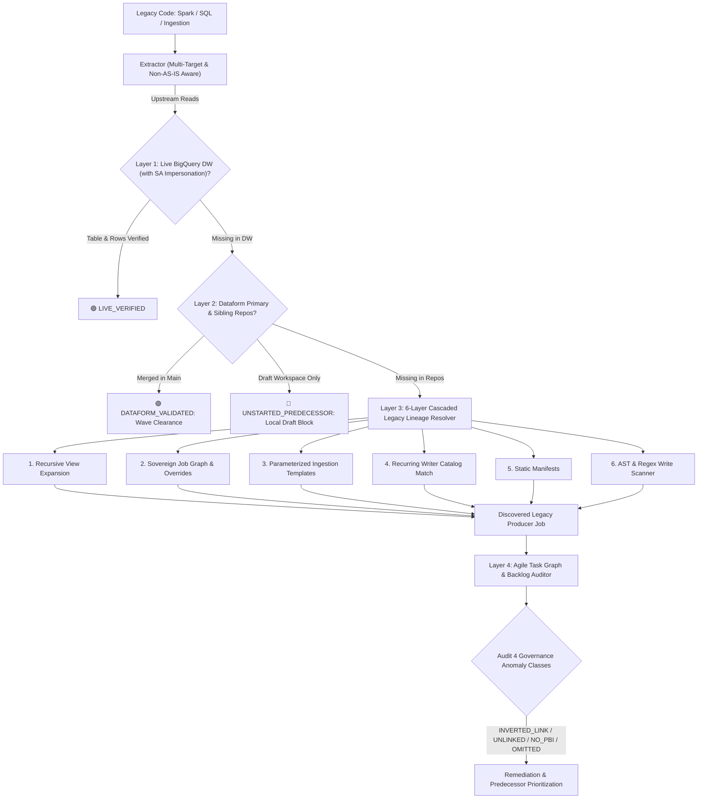

# Data Lineage Upstream Validator

A mission-critical data platform governance skill designed to prevent "phantom development"—where data engineers begin coding or refactoring models only to discover days later that source tables do not exist, contracts are mismatched, or upstream jobs have not been migrated yet.



---

## 🏛️ The 4 Verification Layers

### Layer 1: Data Warehouse Live + SA Impersonation + 0-Rows Predecessor Lock
- Queries BigQuery metadata for physical existence, `num_rows`, and partition update timestamps.
- **Service Account Impersonation Fallback:** If local credentials receive `403 Forbidden`, automatically cascades to the regional worker SA to verify actual table existence.
- **Empty Table Predecessor Lock (`UNPOPULATED_UPSTREAM`):** If a physical table exists in BigQuery but contains `0 rows` (schema shell only) and the producer card is still unstarted (`Pre-Wave` / `Refining`), it is classified as a dependency blocker rather than a false-positive clearance.
- **Ghost Views Resolution & Non-AS-IS Consolidation:** Automatically maps legacy logical views to canonical physical streaming/batch tables (e.g. `silver_platform.eventtracks`), preventing false blockers or phantom targets, and recognizes merged/retired intermediate tables.

### Layer 2: Dataform Repository Fallback + Sibling Projects + Draft Guardrail
- **Wave-Based Modernization:** If the table is not yet materialized in BigQuery production, but its `.sqlx` declaration or table model is merged in the default branch, the skill clears the pipeline (`DATAFORM_VALIDATED`).
- **Sibling Project Support:** Inspects neighboring ingestion repositories and sibling Dataform projects.
- **Draft Workspace Guardrail (`is_draft_workspace`):** Rejects unmerged local drafts from predecessor tasks, marking them as `UNSTARTED_PREDECESSOR` to prevent broken builds against uncommitted code.

### Layer 3: 6-Layer Cascaded Legacy Lineage Resolver (`resolve_legacy_lineage.py`)
When an upstream table is physically missing in BigQuery, this engine automatically determines which legacy job produces it:
1. **Recursive View Expansion:** Recursively unpacks Hive, Spark SQL, and Trino views to identify underlying physical tables.
2. **Sovereign Job Graph & Architectural Overrides:** Traverses dependency graphs (Airflow, Oozie, Control-M, Autosys) and applies sovereign architecture overrides for consolidated models.
3. **Parameterized Ingestion Templates:** Scans generic database-to-lake ingestion configs (CDC/Sqoop/JDBC patterns).
4. **Target Catalog Match with Recurring Writer Scoring:** Evaluates table name stems and execution frequency scores to rank likely writers.
5. **Static Code Metadata:** Parses YAML/JSON pipeline definitions and metadata manifests (supporting list or dict structures and normalizing slashes/special characters in paths).
6. **AST & Regex Write Command Scanner:** Parses source code for physical write operations (`.saveAsTable`, `.insertInto`, `INSERT INTO`, `MERGE INTO`, `CREATE TABLE`).

### Layer 4: Agile Backlog Auditor & The 3-Color Traffic Light Governance
Cross-references discovered legacy producer jobs against Jira/Azure DevOps backlogs and automatically detects **4 classes of governance anomalies**:
1. **`INVERTED_LINK`:** When a predecessor task is erroneously registered as a successor in the agile board (circular/inverted dependency).
2. **`UNLINKED_PREDECESSOR`:** When a real code dependency exists in the backlog but is unlinked on the board.
3. **`PREDECESSOR_WITHOUT_PBI`:** When an upstream table is produced by a legacy routine that does not yet have a card in the backlog.
4. **`OMITTED_SOURCES`:** When sources physically read in legacy code were omitted in the ticket's documentation table.

**Standardized 3-Color Traffic Light Header:**
- `🟢 VERDE (READY)`: 100% of upstream sources exist and are populated, with zero link anomalies or missing dependencies.
- `🟡 AMARELO (TASK DEPENDENCY)`: Blocked waiting for completion of an identified, mapped predecessor card.
- `🔴 VERMELHO (BLOCKED / GOVERNANCE GAP)`: Orphan source without producer card, unpopulated 0-row upstream table, or backlog link anomalies.

---

## 🛠️ CLI Execution & Usage

### Running Lineage Pre-Flight
```bash
python3 skills/data-lineage-upstream-validator/scripts/validate_lineage.py \
  --config /path/to/lineage_config.json \
  --output-md /path/to/lineage_report.md \
  --fail-on-missing
```

### With SA Impersonation Fallback
```bash
python3 skills/data-lineage-upstream-validator/scripts/validate_lineage.py \
  --config /path/to/lineage_config.json \
  --impersonate-sa sa-dataform-executor@acme-dwh-prod.iam.gserviceaccount.com \
  --output-md /path/to/lineage_report.md
```

### Dry-Run Local Mode
```bash
python3 skills/data-lineage-upstream-validator/scripts/validate_lineage.py \
  --config skills/data-lineage-upstream-validator/examples/sample_lineage_graph.json \
  --dry-run \
  --output-md /tmp/lineage_report.md
```
