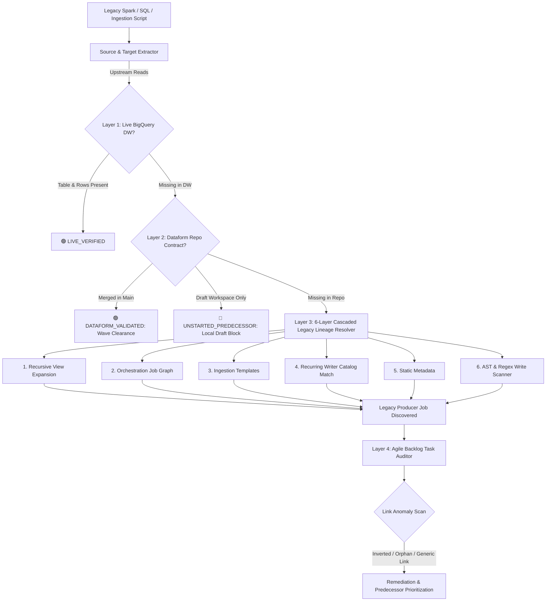

# Data Lineage Upstream Validator

A mission-critical data platform governance skill designed to prevent "phantom development"—where data engineers begin coding or refactoring pipelines only to discover days later that source tables do not exist, contracts are mismatched, or upstream jobs have not been migrated yet.



---

## 🏛️ The 4 Verification Layers

### Layer 1: Data Warehouse Live Physical Verification & Spec Alignment
- Queries BigQuery metadata for physical existence, `num_rows`, and partition update timestamps.
- Asserts strict alignment between work item specifications and physical dataset assets.

### Layer 2: Dataform Repository Contract Fallback (Wave Migrations)
- In large-scale, multi-wave modernization programs, downstream pipelines are frequently refined while upstream pipelines are still in active PR or recently merged.
- **`DATAFORM_VALIDATED`:** If the table is not yet materialized in BigQuery production, but its `.sqlx` declaration or table model is merged in the repository's default branch, the skill clears the pipeline for development.
- **Draft Workspace Guardrail (`is_draft_workspace`):** Rejects unmerged local drafts from predecessor tasks, marking them as `UNSTARTED_PREDECESSOR` to prevent broken builds against uncommitted code.

### Layer 3: 6-Layer Cascaded Legacy Lineage Resolver (`resolve_legacy_lineage.py`)
When an upstream table is physically missing in BigQuery, this engine automatically determines which legacy job produces it:
1. **Recursive View Expansion:** Recursively unpacks Hive, Spark SQL, and Trino views to identify underlying physical tables.
2. **Orchestration Job Graph:** Traverses dependency graphs (Airflow, Oozie, Control-M, Autosys) to match declared output datasets.
3. **Parameterized Ingestion Templates:** Scans generic database-to-lake ingestion configs (CDC/Sqoop/JDBC patterns).
4. **Target Catalog Match with Recurring Writer Score:** Evaluates table name stems and execution frequency scores to rank likely writers.
5. **Static Code Metadata:** Parses YAML/JSON pipeline definitions and metadata manifests.
6. **AST & Regex Write Command Scanner:** Parses source code for physical write operations (`.saveAsTable`, `.insertInto`, `INSERT INTO`, `MERGE INTO`, `CREATE TABLE`).

### Layer 4: Agile Task Graph & Backlog Auditor (`backlog_task_auditor.py`)
- Cross-references the discovered legacy producer job against Jira/Azure DevOps migration backlogs.
- Pinpoints the exact Predecessor Ticket that must be completed.
- Detects link anomalies:
  * **Inverted Dependencies:** When a predecessor incorrectly declares the downstream child as its blocker.
  * **Orphan Predecessors:** When a pipeline consumes an upstream table produced by an active ticket that is unlinked on the agile board.
  * **Generic Orchestrator False Links:** Identifies tickets erroneously linked to global scheduling DAGs (e.g., `daily_cron_master`) instead of the atomic component job.

---

## 🛠️ CLI Execution & Usage

### Running Lineage Pre-Flight
```bash
python3 skills/data-lineage-upstream-validator/scripts/validate_lineage.py \
  --config /path/to/lineage_config.json \
  --output-md /path/to/lineage_report.md \
  --output-json /path/to/lineage_report.json \
  --fail-on-missing
```

### Dry-Run Mode
```bash
python3 skills/data-lineage-upstream-validator/scripts/validate_lineage.py \
  --config skills/data-lineage-upstream-validator/examples/sample_lineage_graph.json \
  --dry-run \
  --output-md /tmp/lineage_report.md
```

---

## 📋 Input Configuration Schema (`lineage_config.json`)

```json
{
  "ticket_id": "MIG-502",
  "default_project": "acme-dwh-prod",
  "code_text": "SELECT c.customer_id, c.customer_name, o.order_id FROM `acme-lakehouse-raw.bronze_erp.customers` c LEFT JOIN `acme-dwh-prod.silver_orders.orders` o ON c.id = o.customer_id",
  "explicit_targets": [
    "acme-dwh-prod.gold_analytics.dim_customer_enriched"
  ],
  "dataform_repo_path": "/path/to/dataform-repo",
  "is_draft_workspace": false,
  "legacy_context": {
    "views": {},
    "job_graph": {},
    "target_catalog": []
  },
  "backlog_items": [
    {
      "ticket_id": "MIG-480",
      "summary": "Migrate ERP Customers to Bronze BigLake",
      "status": "IN_PROGRESS",
      "legacy_jobs": ["legacy_spark_erp_ingestion"],
      "target_tables": ["customers"],
      "predecessor_tickets": []
    }
  ]
}
```

---

## 📦 Output Artifacts

The validator generates an executive dependency clearance report detailing:
1. **Lineage Boundaries:** Clean separation between read sources and write targets.
2. **Upstream Verification Status:** BigQuery physical live checks and Dataform wave contract statuses.
3. **Legacy Producer Resolution:** Cascaded discovery layer, producer job name, and confidence score.
4. **Agile Dependency Actions:** Targeted predecessor ticket priorities and detected link anomalies.
