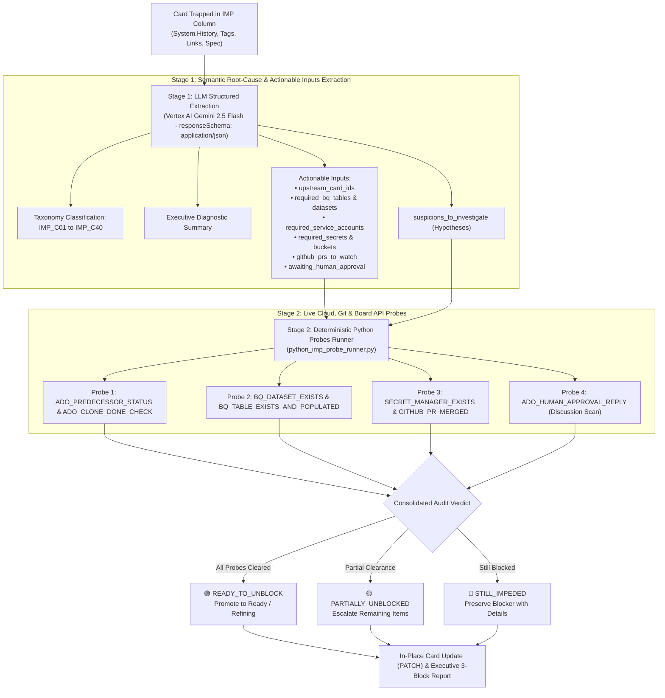

# 🔍 Hybrid Impediment Investigator (Vertex AI Gemini + Deterministic Python Probes)

An enterprise-grade, two-stage deep investigation skill designed to continuously diagnose the root causes of cards trapped in impediment columns (`IMP`) and automatically verify whether blocking conditions have already been resolved in the cloud environment.

It can be executed locally via CLI or deployed as a headless worker inside **Google Cloud Run Jobs** or **Apache Airflow / Cloud Composer**.



---

## 🏛️ Two-Stage Architectural Breakdown

### Stage 1: Structured Extraction via Vertex AI Gemini (`vertex_gemini_imp_extractor.py`)
- **Rich Context Ingestion:** Ingests the full work item discussion timeline (`System.History`), tags, mover identity, origin column, linked work items, and technical specifications.
- **Strict `responseSchema`:** Calls `gemini-2.5-flash` with strict JSON schema enforcement (`application/json`) at low temperature (0.1) for zero hallucination.
- **Root-Cause Taxonomy Classification (`IMP_C01` to `IMP_C40`):**
  Maps impediments to 40 canonical enterprise codes, such as:
  - `IMP_C01`: Unstarted or unpopulated upstream predecessor table (`0 rows`).
  - `IMP_C02`: Predecessor finished as generic orchestrator without creating DW tables.
  - `IMP_C03`: Circular or inverted dependency link on the agile board.
  - `IMP_C04`: Orphan upstream source table without mapped backlog card (`SEM_PBI`).
  - `IMP_C05`: Topological wave inversion (predecessor planned in future wave).
  - `IMP_C07`: Missing BigQuery target or source dataset (`404 Not Found`).
  - `IMP_C08`: Missing Cross-Project IAM ACL (`roles/bigquery.dataViewer`).
  - `IMP_C10`: Secret Manager secret or enabled version missing in target region.
  - `IMP_C12`: External Table Google Sheets Drive permission denied (`403`).
  - `IMP_C17`: Awaiting Cloud Foundation / SRE Terraform provisioning PR.
- **Actionable Inputs Extraction:**
  Extracts precise, machine-verifiable assets:
  - `upstream_card_ids`: Backlog tickets that must finish first.
  - `sibling_or_duplicate_card_ids`: Parallel or twin tickets delivering the same target.
  - `required_bq_tables`: Fully-qualified tables required (`project.dataset.table`).
  - `required_bq_datasets`: BigQuery datasets required in GCP.
  - `required_service_accounts`: IAM identities requiring permissions.
  - `required_secrets`: Cloud Secret Manager resource IDs.
  - `required_gcs_buckets`: Google Cloud Storage bucket URIs.
  - `github_prs_to_watch`: Terraform / repo PRs that must merge.
  - `awaiting_human_approval`: Flag indicating if pending human architect/business decision.
  - `suspicions_to_investigate`: Concrete hypotheses for Stage 2 probe runner.

---

### Stage 2: Deterministic Python Probes Runner (`python_imp_probe_runner.py`)
Reads the actionable inputs and executes real, non-hallucinated API probes:
1. **`ADO_PREDECESSOR_STATUS` & `ADO_CLONE_DONE_CHECK`:**
   - Queries Jira / Azure DevOps APIs to verify if upstream cards have reached `Done` or `Validation`.
   - Checks if a clone/duplicate card was already completed and delivered the target table.
2. **`BQ_DATASET_EXISTS` & `BQ_TABLE_EXISTS_AND_POPULATED`:**
   - Inspects BigQuery REST API to confirm if previously `404` datasets have been provisioned by Terraform.
   - Asserts that upstream source tables physically exist and contain data (`num_rows > 0`).
3. **`SECRET_MANAGER_EXISTS` & `GITHUB_PR_MERGED`:**
   - Inspects Secret Manager API to verify that pending secrets have at least one `ENABLED` version.
   - Inspects GitHub / GitLab APIs to check if blocking infrastructure PRs have merged.
4. **`ADO_HUMAN_APPROVAL_REPLY`:**
   - Scans recent discussion comments to check if a human lead/architect posted the required confirmation.

---

## 🚦 Executive Verdict & Traffic Light Output

| Verdict | Meaning | Action Taken |
| :--- | :--- | :--- |
| **`🟢 READY_TO_UNBLOCK`** | 100% of blocking conditions have been resolved in the environment. | Auto-promotes card to `Ready` / `Refining`, removes `Infra-Blocked` / `IMP` tags, and updates card comment. |
| **`🟡 PARTIALLY_UNBLOCKED`** | Some blockers cleared (e.g. PR merged), but downstream assets still pending (e.g. table has 0 rows). | In-place card comment updated with the exact list of remaining blockers for squad focus. |
| **`🔴 STILL_IMPEDED`** | Blocker conditions remain active in the cloud, Git repo, or board. | Preserves card in impediment and generates structured remediation tasks for SRE / IaC teams. |

---

## 🛠️ CLI Execution & Usage

### 1. Run Complete Hybrid Investigation
```bash
python3 skills/hybrid-impediment-investigator/scripts/hybrid_investigator_orchestrator.py \
  --history-json skills/hybrid-impediment-investigator/examples/sample_impediment_history.json \
  --output-md /tmp/investigation_report.md \
  --output-json /tmp/investigation_result.json \
  --dry-run
```

### 2. Run Stage 1 Extractor Only (Vertex AI Gemini)
```bash
python3 skills/hybrid-impediment-investigator/scripts/vertex_gemini_imp_extractor.py \
  --history-json /path/to/card_history.json \
  --project-id acme-dwh-prod \
  --output-json /tmp/extracted_diagnosis.json
```

### 3. Run Stage 2 Deterministic Probes Only
```bash
python3 skills/hybrid-impediment-investigator/scripts/python_imp_probe_runner.py \
  --diagnosis-json /tmp/extracted_diagnosis.json \
  --card-id CARD-773 \
  --output-md /tmp/probes_report.md
```
