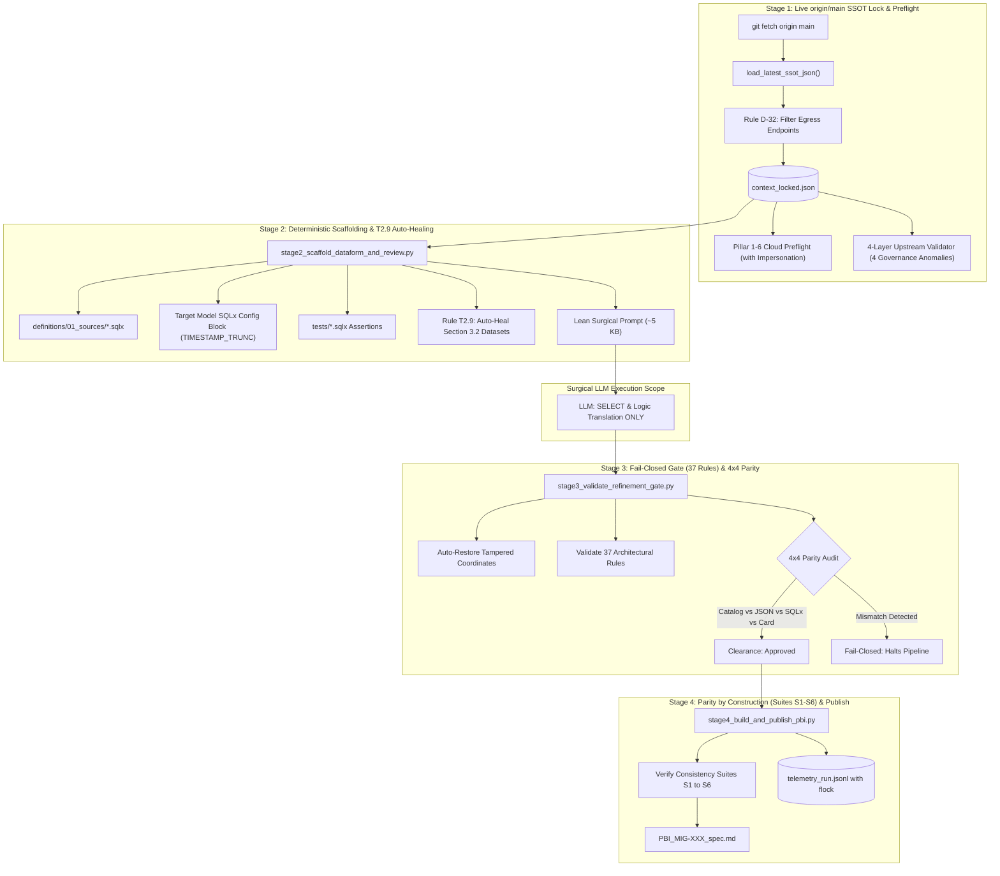

# Migration Spec Refiner (.py-First + Surgical LLM)

A production-grade technical refinement skill that replaces fragile, prompt-only LLM chains (~10 legacy skills) with a **`.py`-First + Surgical LLM** architecture for migrating legacy Databricks / Spark / Lakehouse pipelines to **Google Cloud BigQuery + Dataform + Airflow**.



---

## 🏛️ The 4 Deterministic Stages

### Stage 1: Live `origin/main` SSOT Lock & Pre-Flight (`stage1_resolve_refinement_context.py`)
- **Live SSOT Fetch:** Executes `git fetch origin main` and reads the canonical catalog directly from `origin/main` (`load_latest_ssot_json`) to eliminate local dictionary drift.
- **Alias Normalization:** Normalizes project and dataset aliases (resolving short_names into canonical active GCP projects).
- **Rule D-32 Egress Filtering:** Automatically discards non-table egress destinations (`EMAIL`, `SFTP`, `WEBHOOK`) from target data model representations.
- **Multi-Target & Multi-Region:** Preserves multiple target outputs and parameterizes region strings (`sam, nam, eur` -> `${constants.REGION}`).
- **Immutable Lock:** Generates `context_locked.json` before any model is called and executes preflights.

### Stage 2: Deterministic Scaffolding, T2.9 Auto-Healing & Surgical Prompt (`stage2_scaffold_dataform_and_review.py`)
- **100% Python Scaffolding:**
  * External source declarations: `definitions/01_sources/*.sqlx`
  * Target model headers: `config {}` supporting complex partition expressions like `TIMESTAMP_TRUNC(timestamp_col, DAY)`
  * Unit assertions: `tests/assert_unique_*.sqlx`
  * Mermaid dataflow diagrams
- **Rule T2.9 Auto-Healing:** When an existing specification matches SSOT coordinates, preserves validated business rules and deterministically auto-heals the Required Datasets table (Section `3.2`), guaranteeing 100% of Source and Target datasets are enumerated without omissions.
- **Lean Surgical Prompt (~5 KB):** Restricts the LLM exclusively to translating the `SELECT` query body and drafting an executive summary.

### Stage 3: Fail-Closed Gate of 37 Rules & 4x4 Parity (`stage3_validate_refinement_gate.py`)
- **Coordinate Auto-Restoration:** Automatically restores any schema, table name, or project coordinate that the LLM may have altered, resetting it back to the immutable `context_locked.json`.
- **37 Architectural Consistency Rules:** Lints SQL bodies against hardcoded GCP projects, naked table references, SELECT * projections, and blocks phantom sources.
- **Dataform Dry-Run Compilation:** Generates `compiled_graph.json`.
- **4x4 Parity Audit:** Verifies exact alignment across 4 representations:
  $$\text{SSOT Catalog} \equiv \text{Specification JSON} \equiv \text{Compiled SQLx Graph} \equiv \text{Agile Work Item}$$

### Stage 4: Parity by Construction, Suites S1–S6 & Atomic Telemetry (`stage4_build_and_publish_pbi.py`)
- **Consistency Test Suites S1–S6:** Validates the finalized PBI across 6 automated suites:
  * *Suite S1:* Header and metadata consistency.
  * *Suite S2:* Upstream source declarations vs. Dataform parity.
  * *Suite S3:* SQLx model block and column projection integrity.
  * *Suite S4:* Data quality unit assertions (tests) coverage.
  * *Suite S5:* Required Datasets (Section 3.2) complete enumeration.
  * *Suite S6:* Preflight and lineage diagnostic attachments.
- **Parity by Construction:** Derives all documentation and code structures from the same in-memory object, guaranteeing 100% parity by construction.
- **Atomic Concurrency:** Emits state records and telemetry using file locking (`fcntl.flock`) and atomic flush (`os.replace` / `tempfile`).

---

## 🛠️ CLI Execution & Usage

### Running the End-to-End Refiner Pipeline
```bash
python3 skills/migration-spec-refiner/scripts/refiner_pipeline.py \
  --ticket-id MIG-502 \
  --target-table dim_customer_enriched \
  --catalog skills/migration-spec-refiner/examples/canonical_catalog.json \
  --output-dir ./refinement_artifacts \
  --dry-run
```

### With T2.9 Auto-Healing on Existing Spec
```bash
python3 skills/migration-spec-refiner/scripts/refiner_pipeline.py \
  --ticket-id MIG-502 \
  --target-table dim_customer_enriched \
  --catalog skills/migration-spec-refiner/examples/canonical_catalog.json \
  --existing-spec /path/to/existing_pbi.md \
  --output-dir ./refinement_artifacts \
  --dry-run
```
