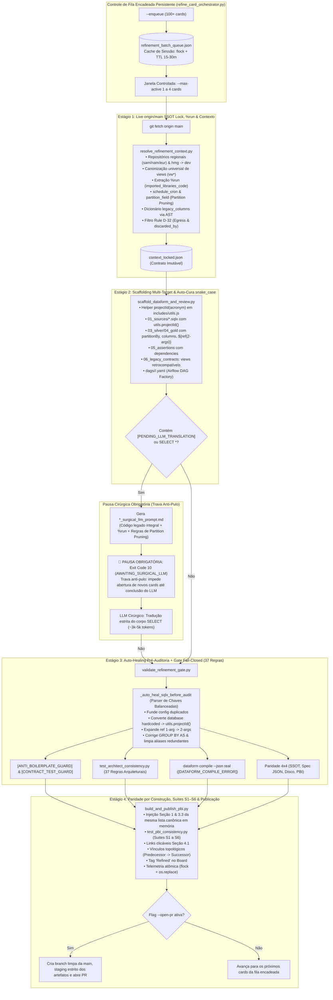

# ⚙️ Migration Spec Refiner (.py-First + Surgical LLM + Micro-Batch Queue)

Skill orquestradora de refinamento técnico de ponta a ponta baseada no paradigma **`.py`-First + LLM Cirúrgico + Fila Encadeada de Micro-Lotes**, substituindo 10 skills legadas multi-agente por **4 ferramentas Python determinísticas** + suíte de validação auto-contida (`scripts/validators/`).



---

## 🏛️ Os 4 Estágios Determinísticos & Arquitetura de Fila

### Controle de Fila Encadeada Persistente (`refine_card_orchestrator.py`)
- **Modos em 2 Fases:** Suporta `--phase pre-llm` (Estágios 1 e 2 até a pausa cirúrgica) e `--phase post-llm` (Auto-healing, Gate 3, Compilação e Publicação).
- **Enfileiramento em Escala:** Comandos `--enqueue <ids...>`, `--next`, `--queue-status`, `--clear-queue` com janela controlada configurável (`--max-active 1` a `4`).
- **Trava Anti-Pulo de Tradução (`Exit Code 10 - AWAITING_SURGICAL_LLM`):** O orquestrador bloqueia a abertura de novos cards enquanto houver cards ativos aguardando tradução cirúrgica do SQL pelo LLM, assegurando zero geração com código incompleto ou placeholders.
- **Auto-Reset de Cache de Sessão:** Limpa automaticamente caches temporários ao iniciar uma nova fila (`--enqueue`/`--clear-queue`), mantendo **Cache de Sessão Seguro (`fcntl.flock`, TTL 15–30 min apenas para resultados positivos `READY`)** entre as fases do mesmo lote.
- **Integração de Esteira:** Flags integradas `--upstream-checker` (dispara auditoria de linhagem imediatamente após a publicação) e `--open-pr` (cria branch isolada a partir de `origin/main`, faz staging estrito dos arquivos gerados e abre/atualiza o Pull Request).

---

### Estágio 1: Live `origin/main` SSOT Lock, Bibliotecas `%run` & Pre-Flight (`resolve_refinement_context.py`)
- **Sincronização SSOT com `origin/main`:** Executa `git fetch origin main` e carrega o catálogo canônico mais recente, resolvendo repositórios regionais (`sam`, `nam`, `eur`), proteção de ambientes de homologação (`hmg` ➔ `dev`), canonização universal de views legadas (`vw*`) e bloqueio contra auto-dependência.
- **Extração Integral de Código e Bibliotecas `%run`:** Carrega o código legado completo (`legacy_code_full`) e resolve recursivamente bibliotecas filhas importadas via `%run` ou imports Python (`imported_libraries_code`).
- **Extração de Metadados Críticos:** Extrai `schedule_cron`, chave de partição (`partition_field` / `bq_partition_field`) e o **dicionário de colunas de destino (`legacy_columns`)** via catálogo ou AST do código.
- **Filtro de Descartados & Egress (Regra D-32):** Descarta automaticamente destinos anotados como `discarded_by` e destinos de egress que não são tabelas (`EMAIL`, `SFTP`, `WEBHOOK`, `DATA_APPLICATION_API`).
- **Contrato Imutável:** Grava `context_locked.json` contendo o estado auditado antes de qualquer scaffold.

---

### Estágio 2: Geração Multi-Target, DAG YAML Canônico & Prompt Cirúrgico (`scaffold_dataform_and_review.py`)
Gera deterministicamente a suíte de artefatos para **todos os destinos do card (`ctx["targets"]` - suporte nativo a Multi-Target)**:
1. `definitions/01_sources/*.sqlx`: Reutiliza declarações existentes na `main` sem duplicar; injeta obrigatoriamente `database: utils.projectId("<acronym>")` em fontes cross-project (`p-*` / `i-*` lidos por `a-*`).
2. `definitions/03_silver/<domain>/<table>.sqlx` (ou `04_gold`):
   - Injeta bloco `config { type: "table", bigquery: { partitionBy: "..." }, columns: { ... } }`.
   - Referencia fontes exclusivamente via `${ref("schema", "tabela")}` (2 argumentos).
   - Normaliza nomes de colunas para `snake_case` sem corromper cláusulas `GROUP BY`.
3. `definitions/05_assertions/<domain>/assert_unique_<table>.sqlx`:
   - Injeta obrigatoriamente `dependencies: ["<target_table>"]` no bloco `config {}`.
4. `definitions/06_legacy_contracts/<domain>/vw_<table>.sqlx`:
   - View de contrato com projeção reversa (`snake_col AS LegacyCol`) para garantir 100% de retrocompatibilidade com dashboards legados.
5. `dags/<region>/<dag_id>.yaml`:
   - Template canônico do **Airflow DAG Factory** com `"vars": {"project_id": "<canonical_source_project>"}` em cenários cross-project.
- **Pausa Obrigatória e Regras de Partition Pruning:** Se qualquer arquivo contiver `[PENDING_LLM_TRANSLATION]` ou `SELECT *`, emite o arquivo `*_surgical_llm_prompt.md` contendo as diretrizes estritas de **Partition Pruning** (exigindo filtro direto sobre a coluna de partição sem envolver em funções como `SAFE_CAST()` ou `DATE()` que desabilitam a poda no BigQuery) e pausa a execução com **`Exit Code 10`**.

---

### Estágio 3: Auto-Healing Pré-Auditoria + Gate Fail-Closed (`validate_refinement_gate.py`)
- **Auto-Healing Estrutural Pré-Auditoria (`_auto_heal_sqlx_before_audit`):**
  Parser determinístico de chaves balanceadas que corrige automaticamente antes da validação:
  * Remove comentários e caracteres espúrios antes do bloco `config {}`;
  * Funde blocos `config {}` duplicados;
  * Converte tokens de `database:` hardcoded para `utils.projectId(...)`;
  * Restaura `schema:` e `name:` divergentes contra o `context_locked.json`;
  * Injeta tags e `partitionBy` ausentes;
  * Expande chamadas `${ref("table")}` de 1 argumento para 2 argumentos `${ref("schema", "table")}`;
  * Corrige cláusulas inválidas `GROUP BY ... AS col`;
  * Remove aliases redundantes (`col AS col`) nas views de contrato legado.
- **Quality Gate Fail-Closed (37 Regras Arquiteturais):**
  * `[ANTI_BOILERPLATE_GUARD]`: Rejeita qualquer placeholder, comentário TODO ou `SELECT * FROM` sem transformação;
  * `[CONTRACT_TEST_GUARD]`: Executa `validators/contract_test.py` para inspecionar integridade de arquivos em disco;
  * Executa `validators/test_architect_consistency.py` validando as **37 regras arquiteturais**;
  * **Compilação Real do Dataform:** Executa `dataform compile --json` (`[DATAFORM_COMPILE_ERROR]`);
  * **Auditoria de Paridade 4x4:** Garante consistência idêntica entre Catálogo SSOT, Especificação JSON, Artefatos em Disco e Documento PBI.

---

### Estágio 4: Paridade por Construção, Suítes S1–S6 & Publicação (`build_and_publish_pbi.py`)
- **Paridade por Construção:** Injeta a Seção 1 (Identificação de Destinos) e a Seção 3.3 (Dicionário de Colunas) a partir da **mesma lista canônica em memória**, eliminando divergências de documentação.
- **Validação de Suítes S1 a S6:** Executa `validators/test_pbi_consistency.py`.
- **Publicação e Rastreabilidade:**
  - Gera links clicáveis para 100% dos artefatos na Seção 4.1;
  - Cria vínculos de dependência na direção topológica correta (`Predecessor` ➔ `Successor`);
  - Aplica a tag `Refined` no gerenciador de tarefas (`--publish-ado`);
  - Grava telemetria de execução com escrita atômica concorrente (`fcntl.flock` + `tempfile` + `os.replace`).

---

## 🛠️ CLI Execution & Usage

### 1. Enfileirar e Executar Fase Pré-LLM (Micro-Lote <=4 cards)
```bash
python3 skills/migration-spec-refiner/scripts/refine_card_orchestrator.py \
  --enqueue MIG-101 MIG-102 MIG-103 MIG-104 \
  --max-active 4 \
  --phase pre-llm
```

### 2. Retomar Fase Pós-LLM após Tradução Cirúrgica (Gate 3 + Compilação + PBI)
```bash
python3 skills/migration-spec-refiner/scripts/refine_card_orchestrator.py \
  --phase post-llm \
  --upstream-checker \
  --open-pr
```

### 3. Consultar Status da Fila Encadeada
```bash
python3 skills/migration-spec-refiner/scripts/refine_card_orchestrator.py --queue-status
```

### 4. Execução Isolada de um Único Card
```bash
python3 skills/migration-spec-refiner/scripts/refiner_pipeline.py \
  --ticket-id MIG-502 \
  --output-dir /tmp/refined_mig_502
```
