# ⚙️ Migration Spec Refiner (.py-First + Surgical LLM + Micro-Batch Queue)

End-to-end technical refinement orchestrator skill founded on the **`.py`-First + Surgical LLM + Chained Micro-Batch** architecture, replacing 10 legacy multi-agent prompt chains with **4 deterministic Python engines** + self-contained architectural and semantic validator suites (`scripts/validators/`).

```mermaid
flowchart TD
    subgraph QUEUE["Persistent Chained Batch Queue Engine (refine_card_orchestrator.py)"]
        ENQ["--enqueue <ids...> (100+ cards)"] --> PERSIST[("refinement_batch_queue.json\nSession Cache: flock + TTL 15-30m")]
        PERSIST --> WIN["Controlled Window: --max-active 1 to 4 cards"]
    end

    subgraph STAGE1["Stage 1: Live origin/main SSOT Lock, %run & Context Resolution"]
        WIN --> FETCH["git fetch origin main"]
        FETCH --> S1["resolve_refinement_context.py\n• Regional repositories (sam/nam/eur) & hmg -> dev\n• Universal view canonization (vw*)\n• %run extraction (imported_libraries_code)\n• schedule_cron & partition_field (Partition Pruning)\n• AST legacy_columns dictionary\n• Rule D-32 filter (Egress & discarded_by)"]
        S1 --> CTX[("context_locked.json (Immutable Contract)")]
    end

    subgraph STAGE2["Stage 2: Multi-Target Scaffolding & snake_case Auto-Healing"]
        CTX --> S2["scaffold_dataform_and_review.py\n• Helper projectId(acronym) in includes/utils.js\n• 01_sources/*.sqlx with utils.projectId()\n• 03_silver/04_gold with partitionBy, columns, ${ref(2-args)}\n• 05_assertions with dependencies\n• 06_legacy_contracts: backward-compatible views\n• dags/<region>/<dag_id>.yaml (Airflow DAG Factory)"]
        S2 --> DETECT{"Contains [PENDING_LLM_TRANSLATION]\nor SELECT *?"}
    end

    subgraph SURGICAL["Mandatory Surgical Translation Pause (Anti-Skip Guard)"]
        DETECT -->|Yes| PROMPT["Generate *_surgical_llm_prompt.md\n(Full Legacy Code + %run + Partition Pruning D-1 Margin)"]
        PROMPT --> PAUSE["🛑 MANDATORY PAUSE: Exit Code 10 (AWAITING_SURGICAL_LLM)\nAnti-skip guard: blocks new cards until LLM finishes SQL translation"]
        PAUSE --> LLM["Surgical LLM: SELECT Body ONLY (~3k-5k tokens)"]
    end

    subgraph STAGE3["Stage 3: Pre-Audit Auto-Healing + BL_00–BL_15 + Fail-Closed Gate"]
        LLM & DETECT -->|No / Ready| S3["validate_refinement_gate.py"]
        S3 --> PURGE["_purge_forbidden_legacy_dataform_files\n(Removes 05_data_migration & 00_ddl)"]
        PURGE --> HEAL["_auto_heal_sqlx_before_audit (Balanced-Brace Parser)\n• Merges duplicate configs\n• Converts database: hardcoded -> utils.projectId()\n• Expands ref 1-arg -> 2-args\n• Corrects GROUP BY AS & cleans redundant aliases"]
        HEAL --> BL["validators/business_logic_validator.py (BL_00 to BL_15)"]
        BL --> G1["[ANTI_BOILERPLATE_GUARD] & [CONTRACT_TEST_GUARD]"]
        G1 --> G2["test_architect_consistency.py (37 Architectural Rules)"]
        G2 --> G3["dataform compile --json real ([DATAFORM_COMPILE_ERROR])"]
        G3 --> G4["4x4 Parity Check (SSOT, Spec JSON, Disk, PBI)"]
    end

    subgraph STAGE4["Stage 4: Parity by Construction, Suites S1–S6 & Publishing"]
        G4 --> S4["build_and_publish_pbi.py\n• Section 1 & 3.3 inlined from identical in-memory canonical list\n• test_pbi_consistency.py (Suites S1 to S6)\n• Clickable links in Section 4.1\n• Predecessor -> Successor topological linking\n• Tag 'Refined' on Board\n• Atomic telemetry (flock + os.replace)"]
        S4 --> PR_CHECK{"Flag --open-pr active?"}
        PR_CHECK -->|Yes| GIT_PR["Creates clean branch from main, stages artifacts strictly & opens PR"]
        PR_CHECK -->|No| NEXT_CARD["Advances to next cards in the chained micro-batch queue"]
    end
```



---

## 🏛️ The 4 Deterministic Stages & Queue Architecture

### Persistent Chained Batch Queue Engine (`refine_card_orchestrator.py`)
- **Two-Phase Execution Modes:** Supports `--phase pre-llm` (Stages 1 and 2 up to surgical pause) and `--phase post-llm` (Purge, Auto-healing, Gate 3, BL_00–BL_15, Compilation, and Publishing).
- **High-Throughput Enqueueing:** CLI commands `--enqueue <ids...>`, `--next`, `--queue-status`, `--clear-queue` with configurable concurrency windows (`--max-active 1` to `4`).
- **Anti-Skip Translation Lock (`Exit Code 10 - AWAITING_SURGICAL_LLM`):** Prevents progressing new cards while any active card awaits surgical SQL translation from the LLM, ensuring zero boilerplate or placeholder leaks in production.
- **Session Cache Auto-Reset:** Automatically resets temporary caches upon initializing a new queue (`--enqueue`/`--clear-queue`), maintaining a **Secure Session Cache (`fcntl.flock`, TTL 15–30 min for positive `READY` outcomes)** between pipeline phases.
- **Continuous Integration Pipeline:** Integrated flags `--upstream-checker` (triggers lineage audit immediately following Stage 4) and `--open-pr` (branches cleanly from `origin/main`, stages strictly batch artifacts, validates Gate 3, and opens/updates the Pull Request).

---

### Stage 1: Live `origin/main` SSOT Lock, `%run` Libraries & Pre-Flight (`resolve_refinement_context.py`)
- **Authoritative `origin/main` Synchronization:** Runs `git fetch origin main` and loads canonical catalogs directly from the default branch, resolving regional repositories (`sam`, `nam`, `eur`), non-production redirect safeguards (`hmg` ➔ `dev`), universal view canonization (`vw*`), and anti-self-dependency guards.
- **Full Source Ingestion & `%run` Inlining:** Loads the entire legacy source script (`legacy_code_full`) and recursively extracts child libraries imported via `%run` or Python imports (`imported_libraries_code`).
- **Metadata Extraction:** Extracts `schedule_cron`, partition keys (`partition_field` / `bq_partition_field`), and the **destination column dictionary (`legacy_columns`)** via catalog or AST source parsing.
- **Discarded Targets & Egress Filter (Rule D-32):** Filters out targets marked `discarded_by` and non-table egress destinations (`EMAIL`, `SFTP`, `WEBHOOK`, `DATA_APPLICATION_API`).
- **Immutable Contract:** Persists `context_locked.json` recording the verified state prior to any scaffolding.

---

### Stage 2: Multi-Target Scaffolding, Canonical DAG YAML & Surgical Prompt (`scaffold_dataform_and_review.py`)
Deterministically scaffolds the complete suite of artifacts for **all card destinations (`ctx["targets"]` - native Multi-Target support)**:
1. `definitions/01_sources/*.sqlx`: Reuses existing definitions from `main` without duplication; injects `database: utils.projectId("<acronym>")` on cross-project sources (`p-*` / `i-*` read by `a-*`).
2. `definitions/03_silver/<domain>/<table>.sqlx` (or `04_gold`):
   - Injects `config { type: "incremental", bigquery: { partitionBy: "..." }, columns: { ... } }`.
   - References upstream tables strictly via `${ref("schema", "table")}` (2 arguments).
   - Normalizes column identifiers to `snake_case` without breaking `GROUP BY` syntax.
3. `definitions/05_assertions/<domain>/assert_unique_<table>.sqlx`:
   - Injects mandatory `dependencies: ["<target_table>"]` in the `config {}` block.
4. `definitions/06_legacy_contracts/<domain>/vw_<table>.sqlx`:
   - Backward-compatible contract view with reverse projection (`snake_col AS LegacyCol`).
5. `dags/<region>/<dag_id>.yaml`:
   - Canonical **Airflow DAG Factory** YAML with `"vars": {"project_id": "<canonical_source_project>"}` in cross-project setups.
- **Mandatory Surgical Pause & Partition Pruning Rules:** If any generated file contains `[PENDING_LLM_TRANSLATION]` or `SELECT *`, emits `*_surgical_llm_prompt.md` containing strict **Partition Pruning guidelines** (mandating direct column predicates without wrapping functions like `SAFE_CAST()` or `DATE()`, and enforcing a **D - 1** margin between UTC physical partitions and local business filters) and pauses execution with **`Exit Code 10`**.

---

### Stage 3: Forbidden Artifact Purge + Pre-Audit Auto-Healing + Semantic Validator BL_00–BL_15 + 37 Rules Gate + Real Compilation (`validate_refinement_gate.py`)
- **Automated Legacy Artifact Purge (`_purge_forbidden_legacy_dataform_files` / `[FORBIDDEN_LEGACY_DATAFORM_ARTIFACTS_GUARD]`):**
  Removes and blocks manual backfill scripts (`05_data_migration/backfill_*.sqlx`), standalone DDLs (`00_ddl/create_*.sqlx`), and nested duplicate subdirectories.
- **Pre-Audit Structural Auto-Healing (`_auto_heal_sqlx_before_audit`):**
  Deterministic balanced-brace parser curing syntax deviations prior to audit:
  * Strips comments and stray characters before `config {}`;
  * Merges duplicate `config {}` blocks;
  * Converts hardcoded `database:` strings to `utils.projectId(...)`;
  * Restores divergent `schema:` and `name:` attributes against `context_locked.json`;
  * Injects missing tags and `partitionBy` clauses;
  * Expands single-arg `${ref("table")}` to 2-arg `${ref("schema", "table")}`;
  * Fixes invalid `GROUP BY ... AS col` clauses;
  * Removes redundant aliases (`col AS col`) in contract views;
  * Auto-heals array JSON serialization to safely guard empty elements (`['[]']`).
- **Business Logic & Semantic Parity Validator (`validators/business_logic_validator.py` — Rules BL_00 to BL_15):**
  * `BL_00_MISSING_TARGET_SQLX`: Guarantees 100% of targets from multi-target cards possess `.sqlx` definitions;
  * `BL_01_INCREMENTAL_DOWNGRADE_TO_TABLE`: Blocks accidental downgrade of incremental models to `type: "table"`;
  * `BL_02_UPSERT_INCREMENTAL_FRAMEWORK`: Validates upsert semantics (`type: "incremental"` + `uniqueKey`);
  * `BL_03_INSERT_NEW_ONLY_FRAMEWORK`: Validates insert-new-only logic (`NOT EXISTS (SELECT 1 FROM ${self()} ...)`);
  * `BL_04_DELETE_FROM_TARGET_FRAMEWORK`: Validates delete-from-target (`DELETE FROM ${self()}` in `pre_operations`);
  * `BL_05_PARTITION_PRUNING_UTC_OFFSET_GUARD`: Audits alias-scoped partition pruning on large tables, guarding against missing D - 1 margins between UTC partitions and local filters;
  * `BL_06_FROM_UTC_TIMESTAMP_GUARD`: Blocks Spark `from_utc_timestamp`, enforcing `DATETIME(..., '<Timezone_Local>')`;
  * `BL_07_ARRAY_JSON_EMPTY_GUARD`: Guards empty array serializations (`['[]']`) before `TO_JSON_STRING`;
  * `BL_08_ANTI_BOILERPLATE_GUARD`: Rejects `[PENDING_LLM_TRANSLATION]`, `TODO`, `PLACEHOLDER`, `1=1`, and `SELECT * FROM`;
  * `BL_09_CONTRACT_TEST_GUARD`: Executes `validators/contract_test.py` to inspect on-disk file integrity;
  * `BL_10_ARCHITECTURAL_RULES_GUARD`: Evaluates the **37 architectural consistency rules**;
  * `BL_11_DATAFORM_COMPILE_ERROR`: Executes real `dataform compile --json` compilation;
  * `BL_12_PARITY_4X4_GUARD`: Asserts 4x4 parity across SSOT Catalog, Spec JSON, Code, and PBI Documentation;
  * `BL_13_LEGACY_CONTRACT_PROJECTION`: Validates backward-compatible projection (`snake_col AS LegacyCol`) in contract views;
  * `BL_14_BIDIRECTIONAL_SCHEMA_TYPE_PARITY`: Asserts bidirectional schema and type parity between legacy Spark and BigQuery;
  * `BL_15_CROSS_SHEET_UNIFIED_JOIN`: Validates unified joins/unions in multi-sheet ingestion consolidation.
- **Unit Test Report Generation:** Generates `unit_test_report_*.md` upon 100% pass across all validation suites.

---

### Stage 4: Parity by Construction, Suites S1–S6 & Publishing (`build_and_publish_pbi.py`)
- **Parity by Construction:** Generates Section 1 (Target Identification) and Section 3.3 (Column Dictionary) from the **identical in-memory canonical list**, eliminating documentation drift.
- **Suites S1 through S6 Validation:** Executes `validators/test_pbi_consistency.py`.
- **Publication & Traceability:**
  - Injects clickable links for 100% of generated artifacts in Section 4.1;
  - Creates agile dependency links in the exact topological direction (`Predecessor` ➔ `Successor`);
  - Applies tag `Refined` in agile board (`--publish-ado`);
  - Records execution telemetry with atomic concurrency locks (`fcntl.flock` + `tempfile` + `os.replace`).

---

## 🛠️ CLI Execution & Usage

### 1. Enqueue and Run Pre-LLM Phase (Micro-Batch <=4 cards)
```bash
python3 skills/migration-spec-refiner/scripts/refine_card_orchestrator.py \
  --enqueue MIG-101 MIG-102 MIG-103 MIG-104 \
  --max-active 4 \
  --phase pre-llm
```

### 2. Resume Post-LLM Phase After Surgical Translation (Gate 3 + Compilation + PBI)
```bash
python3 skills/migration-spec-refiner/scripts/refine_card_orchestrator.py \
  --phase post-llm \
  --upstream-checker \
  --open-pr
```

### 3. Check Queue Status
```bash
python3 skills/migration-spec-refiner/scripts/refine_card_orchestrator.py --queue-status
```

### 4. Standalone Single-Card Refinement
```bash
python3 skills/migration-spec-refiner/scripts/refiner_pipeline.py \
  --ticket-id MIG-502 \
  --output-dir /tmp/refined_mig_502
```
