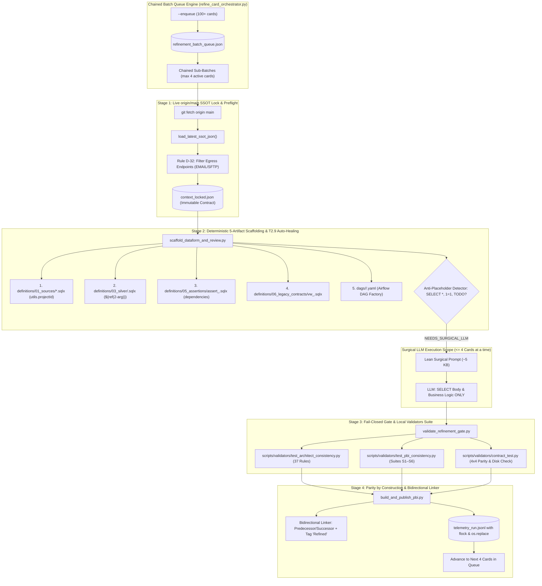

# Migration Spec Refiner (.py-First + Surgical LLM)

A production-grade technical refinement skill that replaces fragile, prompt-only LLM chains (~10 legacy skills) with a **`.py`-First + Surgical LLM** architecture for migrating legacy Databricks / Spark / Lakehouse pipelines to **Google Cloud BigQuery + Dataform + Airflow**.



---

## 🏛️ The 4 Deterministic Stages & Chained Queue Control

### Queue Control: Chained Micro-Batches (`refine_card_orchestrator.py`)
- **Queue Flags:** Supports `--enqueue <ids...>`, `--resume-queue`, and `--max-active 4` (default).
- **Scale-Safe State Persistence:** Accepts 100+ cards at once, persisting state in `refinement_batch_queue.json` and processing them in chained windows of **at most 4 cards simultaneously**.
- **Control Pause on `NEEDS_SURGICAL_LLM`:** Whenever a sub-batch requires SQL translation, the orchestrator pauses with instructions for the LLM to translate only the `.sqlx` of those <=4 cards, validates the fail-closed gate, and automatically rolls into the next 4 cards.

### Stage 1: Live `origin/main` SSOT Lock & Pre-Flight (`resolve_refinement_context.py`)
- **Live SSOT Fetch:** Executes `git fetch origin main` and reads the canonical catalog directly from `origin/main` (`load_latest_ssot_json`), normalizing paths with slashes, spaces, `#`, and supporting both dict and list structures.
- **Rule D-32 Egress & Discard Filtering:** Discards `discarded_by` targets and non-table egress destinations (`EMAIL`, `SFTP`, `WEBHOOK`, `DATA_APPLICATION_API`), preventing accidental `A_DEFINIR_REFINAMENTO` placeholders.
- **Ghost Views Resolution:** Resolves legacy logical views into canonical physical tables.
- **Immutable Lock:** Generates `context_locked.json` before any model is invoked.

### Stage 2: Full Scaffolding of the 5 Coder Artifacts & Canonical DAG YAML (`scaffold_dataform_and_review.py`)
- **Generates 100% Deterministically:**
  1. `definitions/01_sources/*.sqlx`: Reuses declarations already on `main`; injects `database: utils.projectId(...)` for Cross-Project sources (`p-*`/`i-*` vs `a-*`).
  2. `definitions/03_silver/<domain>/<table>.sqlx` (or `04_gold`): References sources strictly via `${ref("schema", "table")}` (2 arguments), with zero hardcoded project/dataset tokens in SQL.
  3. `definitions/05_assertions/<domain>/assert_<table>.sqlx`: Mandatory `dependencies: ["<target_table>"]` in `config {}`.
  4. `definitions/06_legacy_contracts/<domain>/vw_<table>.sqlx`: Mandatory backward compatibility view.
  5. `dags/<region>/<dag_id>.yaml`: Formatted for the canonical **Airflow DAG Factory** schema (`dag_id`, `schedule`, `tags`, `tasks` with `operator` / `bash_command`), auto-injecting `"vars": {"project_id": "<canonical_source_project>"}` when the DAG runs in an analytic project (`a-*`) but compiles ingestion sources (`p-*` / `i-*`).
- **Anti-Placeholder Detector (`NEEDS_SURGICAL_LLM`):** Flags `SELECT *`, `1=1`, `TODO`, or `PLACEHOLDER`, emitting a ~5 KB surgical prompt for the LLM.
- **Rule T2.9 Auto-Healing:** Automatically reconciles the Required Datasets table (Section `3.2`) with the exact union of Sources + Targets.

### Stage 3: Fail-Closed Gate & Local Validators Suite (`validate_refinement_gate.py`)
- **Self-Contained Local Validation Suite (`scripts/validators/`):**
  * `test_architect_consistency.py`: Enforces 37 architectural rules and physical disk inspection.
  * `test_pbi_consistency.py`: Validates suites S1 to S6.
  * `contract_test.py`: Audits 4x4 Parity across SSOT, Spec JSON, SQLx/YAML on disk, and PBI document, asserting that 100% of artifact links point to real files.

### Stage 4: Parity by Construction, Bidirectional Links & Atomic Telemetry (`build_and_publish_pbi.py`)
- **Document Construction:** Builds PBI documents with clickable links to all 5 Coder artifacts and legacy code.
- **Automated Bidirectional Linking:** On publish (`--publish-ado`), creates `Predecessor` and `Successor` links in the Work Item tracker and attaches the `Refined` tag.
- **Atomic Concurrency:** Emits telemetry records using file locking (`flock`) and atomic replace (`tempfile` + `os.replace`).

---

## 🛠️ CLI Execution & Usage

### Running the End-to-End Refiner Pipeline
```bash
python3 skills/migration-spec-refiner/scripts/refiner_pipeline.py \
  --ticket-id MIG-502 \
  --target-table dim_customer_enriched \
  --catalog skills/migration-spec-refiner/examples/canonical_catalog.json \
  --output-dir ./refinement_artifacts \
  --dry-run
```

### With T2.9 Auto-Healing on Existing Spec
```bash
python3 skills/migration-spec-refiner/scripts/refiner_pipeline.py \
  --ticket-id MIG-502 \
  --target-table dim_customer_enriched \
  --catalog skills/migration-spec-refiner/examples/canonical_catalog.json \
  --existing-spec /path/to/existing_pbi.md \
  --output-dir ./refinement_artifacts \
  --dry-run
```
