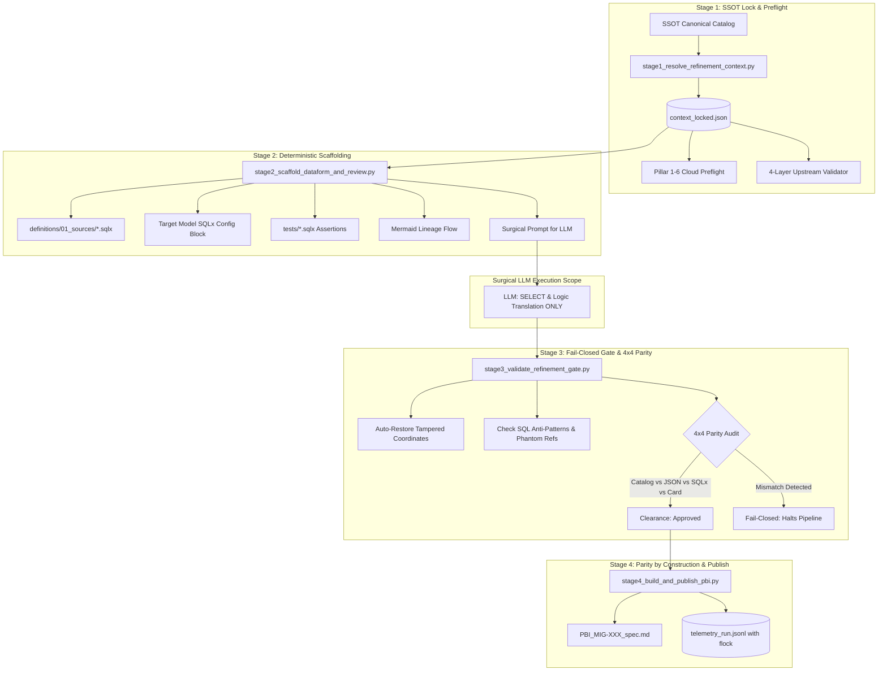

# Migration Spec Refiner (.py-First + Surgical LLM)

A production-grade technical refinement skill that replaces fragile, prompt-only LLM chains with a **`.py`-First + Surgical LLM** architecture for migrating legacy Spark / Hadoop / Data Lakehouse pipelines to **Google Cloud BigQuery + Dataform + Airflow**.



---

## 🏛️ The 4 Deterministic Stages

### Stage 1: SSOT Lock & Preflight (`stage1_resolve_refinement_context.py`)
- Resolves authoritative cloud coordinates (GCP project IDs, dataset tiers, repository URLs, Service Accounts) from canonical SSOT dictionaries.
- Generates an immutable lock artifact `context_locked.json` **before** any LLM is called.
- Invocates `cloud-preflight-infra-auditor` and `data-lineage-upstream-validator` to guarantee environment readiness.

### Stage 2: Deterministic Scaffolding (`stage2_scaffold_dataform_and_review.py`)
- 100% generated via deterministic Python algorithms:
  * Upstream external declarations: `definitions/01_sources/*.sqlx`
  * Target model headers: `config {}` with materialization (`incremental`, `table`, `view`), `uniqueKey`, `partitionBy`, `clusterBy`, and tags.
  * Unit quality tests: `tests/assert_unique_*.sqlx` (primary key and non-null assertions).
  * Dataflow architecture diagrams in Mermaid format.
  * Specification skeleton JSON.
- Formulates a surgical prompt constraining the LLM exclusively to:
  * Translating legacy SQL business transformation logic (`SELECT ...`).
  * Summarizing the technical transformation in 3-4 bullet points.

### Stage 3: Fail-Closed Gate & 4x4 Parity (`stage3_validate_refinement_gate.py`)
- **Auto-Restoration:** Automatically restores any schema, table name, or project coordinate that the LLM may have hallucinated or altered, resetting it back to the immutable `context_locked.json`.
- **Architectural Linter:** Detects hardcoded GCP projects or raw 3-part dataset references in SQL bodies, enforcing Dataform `${ref('...')}` syntax. Blocks phantom sources not present in the SSOT catalog.
- **4x4 Parity Audit:** Verifies exact alignment across 4 representations:
  1. SSOT Canonical Catalog
  2. Specification JSON
  3. Compiled Dataform SQLx Graph
  4. Task Card Document

### Stage 4: Parity by Construction & Atomic Telemetry (`stage4_build_and_publish_pbi.py`)
- Assembles the finalized technical specification document (`PBI_<ID>_spec.md`). Because source tables, configurations, and queries are derived from the same in-memory canonical object, documentation and code divergence drops to **zero by construction**.
- Records state execution metrics and run timestamps using file-locking (`fcntl.flock`) and atomic flush (`os.replace` / `os.fsync`) to prevent concurrency corruption across parallel workers.

---

## 🛠️ CLI Execution & Usage

### Running the End-to-End Refiner Pipeline
```bash
python3 skills/migration-spec-refiner/scripts/refiner_pipeline.py \
  --ticket-id MIG-502 \
  --target-table dim_customer_enriched \
  --catalog skills/migration-spec-refiner/examples/canonical_catalog.json \
  --output-dir ./refinement_artifacts \
  --dry-run
```

### Running Individual Stages
```bash
# Stage 1: SSOT Lock
python3 skills/migration-spec-refiner/scripts/stage1_resolve_refinement_context.py \
  MIG-502 dim_customer_enriched /path/to/catalog.json ./refinement_artifacts

# Stage 2: Scaffolding
python3 -c "
import json
from stage2_scaffold_dataform_and_review import DataformScaffolder
with open('./refinement_artifacts/context_locked.json') as f:
    ctx = json.load(f)
DataformScaffolder().scaffold(ctx, './refinement_artifacts')
"

# Stage 3: Gate & 4x4 Parity Audit
python3 -c "
from stage3_validate_refinement_gate import RefinementGateValidator
res = RefinementGateValidator().validate(
    locked_context_path='./refinement_artifacts/context_locked.json',
    sqlx_model_path='./refinement_artifacts/definitions/02_models/dim_customer_enriched.sqlx'
)
print('Gate Passed:', res.passed)
"
```

---

## 📦 Output Artifacts Generated

```
refinement_artifacts/
├── context_locked.json                   # Immutable SSOT coordinates
├── spec_skeleton.json                    # Scaffolding metadata
├── definitions/
│   ├── 01_sources/
│   │   ├── declaration_bronze_erp_raw_customers.sqlx
│   │   └── declaration_silver_orders_orders_v2.sqlx
│   └── 02_models/
│       └── dim_customer_enriched.sqlx    # Production-ready Dataform model
├── tests/
│   └── assert_unique_dim_customer_enriched.sqlx
├── PBI_MIG-502_spec.md                   # Final publication card with 100% parity
└── telemetry_run.jsonl                   # Atomic telemetry audit log
```
